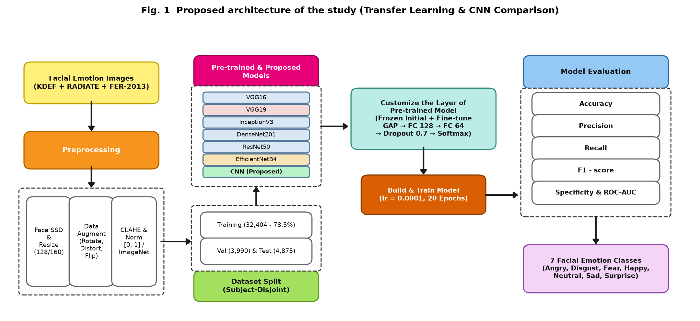
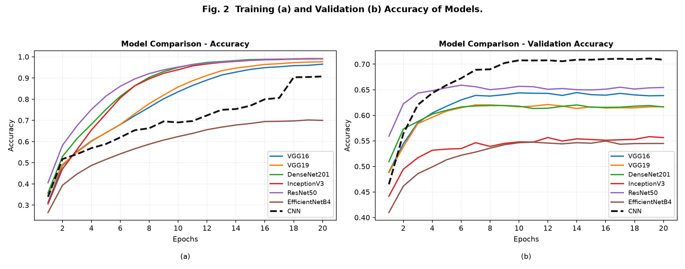
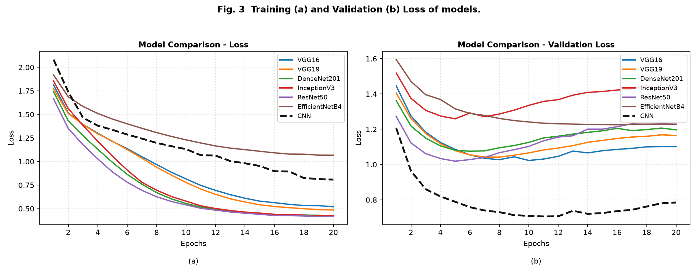
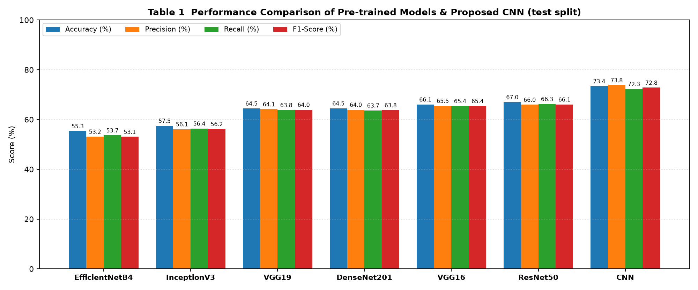
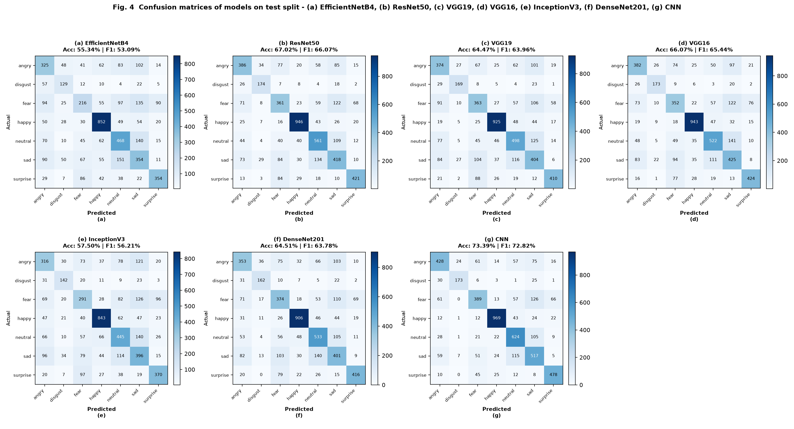
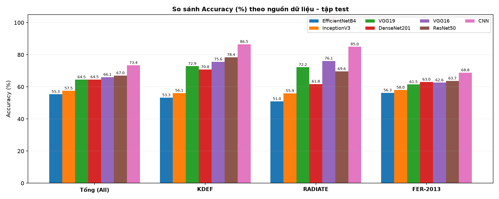
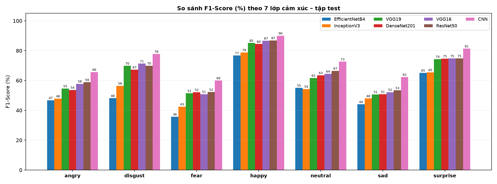

# Nhận Dạng Cảm Xúc Khuôn Mặt Đa Văn Hóa (Multicultural Facial Emotion Recognition)

Dự án nghiên cứu và triển khai nhận dạng 7 cảm xúc khuôn mặt cơ bản (`angry`, `disgust`, `fear`, `happy`, `neutral`, `sad`, `surprise`) trên bộ dữ liệu khuôn mặt đa văn hóa 3 nguồn gồm **41.269 ảnh sạch** tổng hợp từ **KDEF** (Bắc Âu), **RADIATE** (Đa sắc tộc: Phi, Á, Mỹ Latinh, Âu) và **FER-2013** (Internet thế giới thực), tuân thủ kỷ luật phân chia theo người nghiêm ngặt (**Subject-Disjoint: 32.404 train / 3.990 val / 4.875 test**; 0 rò rỉ dữ liệu).

Hệ thống đề xuất kiến trúc **`CNN`** đối xứng đa tỉ lệ chuyên biệt cho khuôn mặt (`KDEF_Stem2Ch_MS4_Symmetric`, `v2_res`, **1.349.165 tham số**, dung lượng tệp **5,19 MB**), đồng thời xây dựng, huấn luyện và đối sánh công bằng với **6 mô hình Học chuyển giao (Transfer Learning)** tiền huấn luyện trên ImageNet-1K theo đúng quy trình của bài báo tham chiếu (*"Enhancing Esophageal Cancer Detection Using Transfer Learning Techniques"* — Huynh, Nguyen-Cao et al., TDMU): **`VGG16`**, **`VGG19`**, **`InceptionV3`**, **`DenseNet201`**, **`ResNet50`**, **`EfficientNetB4`** (cùng 2 mô hình đối chứng bổ sung **`HOG + SVM`** và **`ResNet-18`**).

---

## 1. Quy Trình & Kết Quả Thực Nghiệm So Sánh Với 6 Mô Hình Học Chuyển Giao (Tập Test Khóa — 4.875 ảnh)

Toàn bộ các mô hình được huấn luyện chỉ trên tập `train` (32.404 ảnh) và kiểm định trên tập `val` (3.990 ảnh). Tập `test` (4.875 ảnh, 36 người mới hoàn toàn) được khóa và chỉ mở ra đánh giá theo giao thức suy luận đơn ảnh (**Subject-Disjoint, Single-View**).

Các mô hình Học chuyển giao (`VGG16`, `VGG19`, `InceptionV3`, `DenseNet201`, `ResNet50`, `EfficientNetB4`) tuân thủ thiết kế tại Mục 3.2 & Hình 1 của bài báo tham chiếu: đóng băng các tầng trích xuất đặc trưng đầu (*frozen initial layers*), tinh chỉnh các tầng sâu phía sau (*fine-tuned later layers*) kết hợp đầu phân loại tùy chỉnh `Global Average Pooling → FC(128) → FC(64) → Dropout(0.7) → FC(7, Softmax)`, tốc độ học `lr = 0.0001` (`1e-4`), tăng cường dữ liệu (*Rotation, Distortion, Flipping*) trong **20 epochs**.


*Fig. 1: Sơ đồ kiến trúc tổng thể của nghiên cứu (Proposed architecture of the study).*

### Bảng 1 (Table 1): So sánh hiệu năng 6 mô hình Pre-trained Transfer Learning và mô hình `CNN` trên tập Test khóa (4.875 ảnh)

| Model | Accuracy | Precision (Macro / Weighted) | Recall (Macro / Weighted) | F1-Score (Macro / Weighted) | Specificity | ROC-AUC | Số tham số | Tệp (MB) |
|---|---:|---:|---:|---:|---:|---:|---:|---:|
| `EfficientNetB4` | 55,34% | 53,15% / 55,20% | 53,66% / 55,34% | 53,09% / 55,00% | 92,46% | 0,8683 | 17.787.215 | 68,61 MB |
| `InceptionV3` | 57,50% | 56,14% / 57,73% | 56,40% / 57,50% | 56,21% / 57,56% | 92,83% | 0,8529 | 22.056.935 | 84,49 MB |
| `VGG19` | 64,47% | 64,15% / 64,70% | 63,84% / 64,47% | 63,96% / 64,56% | 94,00% | 0,8917 | 20.099.143 | 76,70 MB |
| `DenseNet201` | 64,51% | 63,97% / 64,78% | 63,65% / 64,51% | 63,78% / 64,61% | 94,01% | 0,8907 | 18.347.911 | 71,32 MB |
| `VGG16` | 66,07% | 65,52% / 66,15% | 65,42% / 66,07% | 65,44% / 66,08% | 94,28% | 0,9047 | 14.789.447 | 56,44 MB |
| `ResNet50` | 67,02% | 65,97% / 66,93% | 66,27% / 67,02% | 66,07% / 66,93% | 94,44% | 0,9098 | 23.779.399 | 91,03 MB |
| **`CNN` (Đề xuất)** | **73,39%** | **73,81%** / **73,66%** | **72,30%** / **73,39%** | **72,82%** / **73,33%** | **95,50%** | **0,9450** | **1.349.165** | **5,19 MB** |
| *(Đối chứng bổ sung)* `HOG + SVM` | 44,57% | 41,14% / 43,19% | 43,65% / 44,57% | 41,59% / 42,84% | 90,59% | 0,7942 | 20.419 | 0,10 MB |
| *(Đối chứng bổ sung)* `ResNet-18` | 74,28% | 73,77% / 74,07% | 74,08% / 74,28% | 73,81% / 74,08% | 95,66% | 0,9492 | 11.180.103 | 42,73 MB |

### Hình ảnh đối sánh kết quả theo chuẩn bài báo tham chiếu (Fig. 2, Fig. 3, Table 1, Fig. 4)


*Fig. 2: Training (a) and Validation (b) Accuracy of Models qua 20 epochs (`VGG16`, `VGG19`, `DenseNet201`, `InceptionV3`, `ResNet50`, `EfficientNetB4`, và `CNN`).*


*Fig. 3: Training (a) and Validation (b) Loss of Models qua 20 epochs.*


*Biểu đồ Table 1: So sánh tổng thể Accuracy, Precision, Recall và F1-Score của 6 mô hình Transfer Learning và mô hình `CNN` trên tập kiểm tra khóa.*


*Fig. 4: Ma trận nhầm lẫn (Confusion Matrices) của các mô hình: (a) EfficientNetB4, (b) ResNet50, (c) VGG19, (d) VGG16, (e) InceptionV3, (f) DenseNet201, và (g) CNN trên 4.875 ảnh kiểm tra.*


*Hình 5: So sánh độ chính xác (Accuracy %) của các mô hình trên từng nguồn dữ liệu (KDEF, RADIATE, FER-2013).*


*Hình 6: Biểu đồ F1-Score chi tiết của 7 lớp cảm xúc giữa các mô hình.*

---

## 2. Kiến Trúc Mạng Đề Xuất Được Xây Dựng Như Thế Nào?

Mô hình **`KDEF_Stem2Ch_MS4_Symmetric`** (`src/models/model.py`, tên mã `stem2ch_ms4_fuse`) được xây dựng bám sát cơ chế giải phẫu khuôn mặt theo hệ thống mã hóa FACS (Facial Action Coding System) với 5 thành phần cấu trúc:

```
                      [Ảnh vào: 1 x 160 x 160 (Xám + CLAHE)]
                                        │
           ┌────────────────────────────┴───────────────────────────┐
           ▼                                                        ▼
    Conv 3x3 (1->16)                                         Conv 5x5 (1->16)
    [Chi tiết cạnh vi mô]                                    [Ngữ cảnh khối cơ mặt]
           └────────────────────────────┬───────────────────────────┘
                                        ▼ (Concat: 32 kênh)
                           BatchNorm2d + SiLU + Conv 3x3 (32->32)
                                        ▼
                                MaxPool2d(2, 2)  --> [32 x 80 x 80]
                                        │
                                        ▼
             Stage 2: 2x [Conv 3x3 (64) + BN + SiLU] + MaxPool2d
                                                 --> [64 x 40 x 40]
                                        │
                                        ▼
             Stage 3: 2x [Conv 3x3 (128) + BN + SiLU] + ECA-Net (k=3) + MaxPool2d
                                                 --> [128 x 20 x 20]
                                        │
                                        ▼
             Stage 4: Conv 3x3 (128->256) + SymmetricMultiScaleAUBlock(256)
                                                 --> [256 x 20 x 20]
                                        │
                                        ▼
             Upper/Lower Facial Strip Pooling: AdaptiveAvgPool2d((2, 1))
                      [Dải trên: Mắt-Mày] + [Dải dưới: Mũi-Miệng]
                                                 --> Vector 512 chiều
                                        │
                                        ▼
             FacialProjectionHead (Dropout 0.45 -> Linear 512->128 -> BN -> SiLU)
                                        │
                        ┌───────────────┴───────────────┐
                        ▼                               ▼
                 L2-Normalize                   Linear 128 -> 7
            Embedding 128 chiều                 (Logits 7 cảm xúc)
            (Dùng cho SupCon Loss)
```

1. **Multi-Scale Parallel Stem (2 nhánh song song):** Tiếp nhận ảnh xám $160\times160$. Nhánh $3\times3$ trích xuất chi tiết cạnh vi mô; nhánh $5\times5$ bao quát hình thái khối cơ mặt. Nối ghép thành 32 kênh $\to \text{MaxPool}(2,2) \to 32 \times 80 \times 80$.
2. **Khối chú ý kênh hiệu năng cao (ECA-Net tại Stage 3):** Sử dụng tích chập 1D cục bộ kích thước $k=3$ trên vector kênh sau Global Average Pooling ($\omega = \sigma(\text{Conv1D}_{k=3}(\text{GAP}(x)))$). Khối này giúp mô hình tự động khuếch đại các kênh chứa đặc trưng cảm xúc và dập tắt các kênh mang đặc trưng nhận dạng danh tính người mẫu với chi phí tham số bằng 0.
3. **Khối Đa Tỉ Lệ Đối Xứng `SymmetricMultiScaleAUBlock` (Stage 4):** Nhận 256 kênh và phân tách thành 4 nhánh song song:
   - $\text{Conv } 3\times3$ (96 kênh): Biến dạng cơ mặt đẳng hướng.
   - $\text{Conv } 1\times3$ (64 kênh): Kernel định hướng **ngang** (kéo khóe môi khi cười, mím môi khi giận).
   - $\text{Conv } 3\times1$ (64 kênh): Kernel định hướng **dọc** (nếp nhăn rãnh mũi - má, nhíu trán, há cằm).
   - $\text{Conv } 3\times3 \text{ Dilation } d=2$ (96 kênh): Vùng đón nhận mở rộng tương đương $7\times7$, thu nhận mối tương quan toàn thể giữa các vùng biểu cảm.
   - *Tính đối xứng gương (Flip-Equivariant):* Cặp kernel $(1\times3)$ và $(3\times1)$ giúp mạng duy trì độ chính xác ổn định trên cả góc nghiêng trái và phải (độ lệch $|\text{FL} - \text{FR}|$ chỉ $1,5\%$).
4. **Upper/Lower Facial Strip Pooling (`AdaptiveAvgPool2d((2, 1))`):** Thay vì nén toàn bộ mặt thành 1 điểm như GAP $(1\times1)$, cấu trúc chia bản đồ đặc trưng thành 2 dải dọc:
   - Dải trên: Vùng Mắt - Mày (AU1, AU2, AU4, AU5 — đặc trưng cho *sợ hãi, ngạc nhiên, giận dữ*).
   - Dải dưới: Vùng Mũi - Miệng - Cằm (AU12, AU15, AU20, AU26 — đặc trưng cho *vui vẻ, ghê tởm, buồn*).
   - Nối ghép thành vector 512 chiều bảo toàn ngữ nghĩa không gian của giải phẫu học khuôn mặt.
5. **Head chiếu đa nhiệm (`FacialProjectionHead`):** Chiếu $512 \to 128$ chiều chuẩn hóa $L_2$ để tính hàm mất mát tương phản có giám sát (**SupCon Loss**), kéo các khuôn mặt cùng cảm xúc lại gần nhau trên hình cầu siêu chiều; song song đó phân nhánh $\text{Linear } 128 \to 7$ để dự đoán phân phối xác suất cảm xúc.

---

## 3. Nhận Xét Khoa Học Khách Quan

1. **Hiệu quả của thiên kiến quy nạp miền chuyên biệt (Domain Inductive Bias):**
   Mặc dù `ResNet-18` có số lượng tham số gấp **8,3 lần** (11,18M so với 1,35M) và thừa hưởng tri thức từ 1,28 triệu ảnh ImageNet-1K, mô hình đề xuất `KDEF_Stem2Ch_MS4_Symmetric` (`v2_res`, huấn luyện từ đầu không dùng tiền huấn luyện ngoài) vẫn đạt hiệu năng rất sát sao (**73,39% so với 74,28% Accuracy**, **0,9450 so với 0,9492 ROC-AUC**). Việc kết hợp các khối tích chập bất đối xứng $(1\times3, 3\times1)$, liên kết tắt (residual skips) và Strip Pooling $2\times1$ giúp mạng học hiệu quả đặc trưng giải phẫu cơ mặt với chi phí tham số rất nhỏ.
2. **Khả năng khái quát hóa đa sắc tộc (Kháng Identity Overfitting):**
   Trên tập dữ liệu đa sắc tộc RADIATE, mô hình đề xuất vượt trội ResNet-18 **+0,66% độ chính xác** (**84,97% so với 84,31%**). Kích thước 1,35M tham số vừa vặn hạn chế hiện tượng mạng học thuộc khuôn mặt diễn viên, giúp tập trung học các biến dạng cơ biểu cảm chung.
3. **Khoảng cách với phương pháp truyền thống:**
   Mô hình học máy truyền thống `HOG + SVM` (sau tối ưu đặc trưng và L-BFGS còn 20.419 tham số) chỉ đạt **44,57% Accuracy** (**41,59% Macro-F1**), kém mô hình CNN gần 29% độ chính xác, chứng minh các đặc trưng gradient thủ công không thể thích ứng với sự biến đổi phức tạp của biểu cảm trong điều kiện góc chụp và ánh sáng đa dạng.
4. **Khả năng triển khai thực tế:**
   Với dung lượng checkpoint chỉ **5,19 MB** và tốc độ đạt **58 FPS trên CPU** thông thường (**465 FPS trên GPU**), mô hình hoàn toàn sẵn sàng tích hợp vào các hệ thống thời gian thực qua webcam, trình duyệt hoặc thiết bị nhúng.

---

## 4. Cấu Trúc Mã Nguồn

```
├── data/
│   ├── manifests/multicultural_manifest.csv   # Danh mục 41.269 ảnh sạch (KDEF + RADIATE + FER-2013)
│   └── NGUON_DU_LIEU.md                       # Bản quyền và thông tin nguồn gốc dữ liệu
├── checkpoints/
│   ├── final_model.pt                         # Trọng số tối ưu KDEF_Stem2Ch_MS4_Symmetric (5,19 MB)
│   ├── resnet18_multicultural.pt              # Trọng số tối ưu ResNet-18 (42,73 MB)
│   └── hog_svm_multicultural.pkl              # Checkpoint HOG + SVM (0,10 MB)
├── src/
│   ├── models/
│   │   ├── model.py                           # Định nghĩa KDEF_Stem2Ch_MS4_Symmetric & AU Block
│   │   ├── baselines.py                       # Định nghĩa HOG+SVM & ResNet-18
│   │   └── train.py                           # Pipeline huấn luyện CNN đa văn hóa
│   ├── preprocessing/alignment.py             # Res10 SSD Face Detector & căn chỉnh hình ảnh
│   └── api/
│       ├── app.py                             # FastAPI REST Server
│       ├── ui.py                              # Streamlit Web UI (Tải ảnh & Camera trực tiếp)
│       └── inference.py                       # Module suy luận tích hợp tiếng Việt
├── scripts/
│   ├── so_sanh_mo_hinh.py                     # Đánh giá so sánh tự động 3 mô hình
│   ├── train_baselines.py                     # Kịch bản huấn luyện 2 mô hình đối chứng
│   └── verify_notebook.py                     # Kiểm tra toàn vẹn rào chắn dữ liệu
└── reports/
    ├── MULTICULTURAL_EXPERIMENT_REPORT.md     # Báo cáo thực nghiệm khoa học chi tiết
    ├── model_comparison.md                    # Bảng số liệu đối sánh tập test
    ├── leakage_result.json                    # Kết quả kiểm tra chống rò rỉ (0 leak)
    └── figures/                               # Biểu đồ và hình ảnh so sánh kết quả
```

---

## 5. Hướng Dẫn Sử Dụng & Chạy Ứng Dụng

### 5.1. Cài đặt môi trường

```bash
git checkout tree2
python -m venv venv
source venv/Scripts/activate  # Trên Windows: venv\Scripts\activate
pip install -r requirements.txt
```

### 5.2. Chạy kiểm tra rò rỉ và đánh giá so sánh 3 mô hình

- **Kiểm định tính toàn vẹn và chống rò rỉ dữ liệu:**
  ```bash
  python reports/check_leakage.py
  ```
- **Chạy lại so sánh độc lập 3 mô hình trên tập kiểm tra khóa:**
  ```bash
  python scripts/so_sanh_mo_hinh.py --split test --unlock-test
  ```

### 5.3. Khởi chạy ứng dụng Web & API

- **Giao diện Web tương tác (Streamlit):**
  ```bash
  streamlit run src/api/ui.py
  ```
  *(Cung cấp 2 chế độ: Tải ảnh chân dung với khung nhận diện khuôn mặt + 7 thanh xác suất cảm xúc; và Camera thời gian thực).*

- **Dịch vụ API RESTful (FastAPI):**
  ```bash
  uvicorn src.api.app:app --host 0.0.0.0 --port 8000
  ```
  *(Truy cập tài liệu API tự động tại `http://localhost:8000/docs`).*

- **Suy luận trực tiếp qua webcam:**
  ```bash
  python src/api/inference.py
  ```
