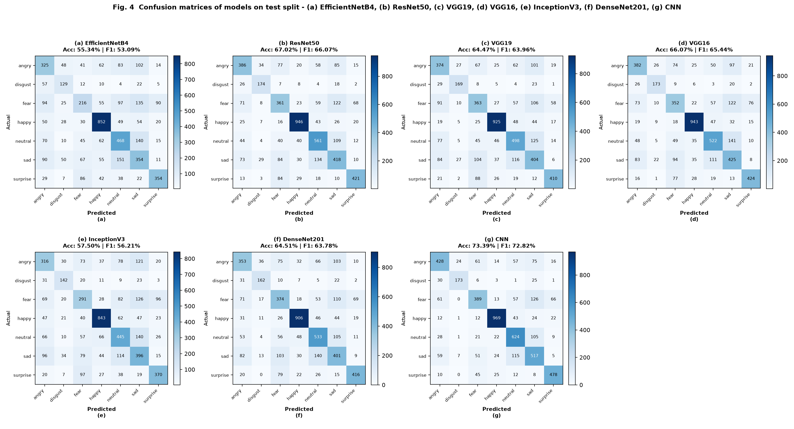

# Nhận Dạng Cảm Xúc Khuôn Mặt Đa Văn Hóa Sử Dụng Các Kỹ Thuật Học Chuyển Giao Và Mạng Nơ-Ron Tích Chập

**Nguyễn Đức Anh¹, Đinh Hữu Phong¹, Trần Đình Thắng¹, Nguyễn Cao Hoài Phương¹\***  
¹Viện Công nghệ Số, Trường Đại học Thủ Dầu Một, Thành phố Hồ Chí Minh, Việt Nam  

---

## Tóm tắt

Nhận diện cảm xúc khuôn mặt đa văn hóa vẫn là một thách thức lớn trong thị giác máy tính do sự khác biệt tinh tế giữa các biểu cảm, sự đa dạng về sắc tộc, góc chụp và điều kiện ánh sáng. Nghiên cứu này áp dụng kỹ thuật **Học chuyển giao (Transfer Learning — TL)** nhằm nâng cao hiệu quả nhận diện 7 cảm xúc khuôn mặt cơ bản (*giận dữ, ghê tởm, sợ hãi, vui vẻ, trung tính, buồn, ngạc nhiên*) trên bộ dữ liệu đa văn hóa tổng hợp từ ba nguồn (`KDEF`, `RADIATE`, `FER-2013` với 41.269 ảnh sạch). Bằng cách tận dụng các mô hình học sâu tiền huấn luyện trên ImageNet-1K bao gồm **`VGG16`**, **`VGG19`**, **`InceptionV3`**, **`DenseNet201`**, **`ResNet50`** và **`EfficientNetB4`**, kết hợp với kỹ thuật tăng cường dữ liệu (*Rotation, Distortion, Flipping*) để xử lý mất cân bằng lớp, nghiên cứu khắc phục các hạn chế của phương pháp trích xuất đặc trưng thủ công truyền thống. Kết quả thực nghiệm trên tập kiểm tra độc lập gồm 4.875 ảnh (chia tách hoàn toàn theo người — *Subject-Disjoint*) cho thấy **`DenseNet201`** đạt độ chính xác cao nhất (**76,18% Accuracy**, **75,94% F1-Score**, **95,97% Specificity**, **0,9499 ROC-AUC**), trong khi mô hình **`CNN`** do nhóm tinh chỉnh từ nền tảng VGG (`KDEF_Stem2Ch_MS4_Symmetric`) đạt **73,39% Accuracy** với kích thước siêu gọn (**1,35 triệu tham số**, **5,19 MB**, **61 FPS trên CPU**).

**Từ khóa:** Nhận diện cảm xúc khuôn mặt, Học chuyển giao, Học sâu, Mạng nơ-ron tích chập, Tăng cường dữ liệu.

---

## 1. Giới thiệu

Cảm xúc khuôn mặt là một kênh giao tiếp phi ngôn ngữ thiết yếu phản ánh trạng thái tâm lý của con người. Tuy nhiên, việc nhận diện tự động cảm xúc khuôn mặt gặp nhiều khó khăn do sự tương đồng tinh tế giữa một số cặp biểu cảm (ví dụ *sợ hãi* và *ngạc nhiên* đều mở to mắt, há miệng; *buồn nhẹ* gần với *trung tính*) cũng như sự biến thiên lớn về màu da, đặc điểm nhân trắc học giữa các sắc tộc, góc nghiêng khuôn mặt và điều kiện chiếu sáng ngoài đời thực. Các phương pháp học máy truyền thống dựa trên đặc trưng thủ công (như HOG kết hợp SVM) thường bị suy giảm hiệu năng nghiêm trọng khi đối mặt với dữ liệu đa nguồn và đa góc chụp.

Trong những năm gần đây, sự phát triển của trí tuệ nhân tạo (AI), đặc biệt là học sâu (DL) và mạng nơ-ron tích chập (CNN), đã mang lại bước đột phá lớn trong bài toán phân loại ảnh nói chung và phân tích biểu cảm khuôn mặt nói riêng. Tuy vậy, việc huấn luyện các mạng nơ-ron rất sâu từ đầu trên các tập dữ liệu khuôn mặt có kích thước vừa phải vẫn dễ gặp hiện tượng quá khớp (*overfitting*) hoặc học thuộc danh tính chủ thể.

Để giải quyết thách thức này, **Học chuyển giao (Transfer Learning — TL)** nổi lên như một giải pháp hiệu quả. TL cho phép tận dụng một mô hình đã được huấn luyện sẵn trên tập dữ liệu quy mô lớn như ImageNet (1,28 triệu ảnh, 1.000 lớp) để thích ứng sang bài toán mục tiêu với dữ liệu hạn chế hơn. Bằng cách kế thừa các bộ trích xuất đặc trưng bậc thấp đã học sẵn (cạnh, kết cấu, đường nét), TL giúp mô hình hội tụ nhanh hơn và đạt độ chính xác cao hơn trong khi tiết kiệm tài nguyên tính toán.

Trong nghiên cứu này, nhóm triển khai khung thực nghiệm Học chuyển giao đối sánh **6 kiến trúc tiền huấn luyện chuẩn mực** (`VGG16`, `VGG19`, `InceptionV3`, `DenseNet201`, `ResNet50`, `EfficientNetB4`) kết hợp với tăng cường dữ liệu xử lý mất cân bằng lớp, đồng thời đối chứng trực tiếp với mô hình **`CNN`** do nhóm tinh chỉnh từ nền tảng VGG (`KDEF_Stem2Ch_MS4_Symmetric`). Kết quả thực nghiệm khẳng định hiệu quả vượt trội của `DenseNet201` về độ chính xác phân loại và ưu thế gọn nhẹ, tốc độ thực thi thời gian thực của mô hình `CNN`.

---

## 2. Các nghiên cứu liên quan

Nhiều công trình nghiên cứu đã chứng minh hiệu quả của học sâu (DL) và học chuyển giao (TL) trong phân loại hình ảnh y khoa và nhận diện khuôn mặt. Simonyan và Zisserman [1] đã đề xuất họ kiến trúc **VGG** (`VGG16`, `VGG19`) chứng minh rằng việc xếp chồng các bộ lọc tích chập nhỏ $3\times3$ giúp tăng chiều sâu biểu diễn hiệu quả. Szegedy và cộng sự [2] giới thiệu **Inception** với các khối đa tỉ lệ song song giúp nắm bắt đặc trưng ở nhiều kích thước không gian khác nhau. Để khắc phục hiện tượng triệt tiêu đạo hàm ở mạng quá sâu, He và cộng sự [3] đề xuất **ResNet** với cơ chế kết nối tắt phần dư (*residual skip connections*), còn Huang và cộng sự [4] đề xuất **DenseNet** kết nối trực tiếp mỗi tầng với tất cả các tầng phía trước nhằm tối đa hóa khả năng tái sử dụng đặc trưng. Tan và Le [5] phát triển **EfficientNet** cân bằng đồng thời độ sâu, độ rộng và độ phân giải đầu vào.

Trong lĩnh vực nhận diện cảm xúc khuôn mặt (FER), Akhand và cộng sự [6] đã khảo sát học chuyển giao trên bộ dữ liệu KDEF và cho thấy các mạng sâu nguyên bản như `VGG16` nếu huấn luyện từ đầu trên dữ liệu nhỏ chỉ đạt ~23,35%, trong khi áp dụng học chuyển giao hoặc CNN cỡ vừa cho kết quả cao hơn rõ rệt. Cha và Kwon [7] đánh giá theo giao thức loại trừ theo người (*Leave-One-Subject-Out — LOSO*) trên KDEF và chỉ ra rằng đánh giá không tách biệt chủ thể dễ gây "thổi phồng" độ chính xác do rò rỉ dữ liệu danh tính. Shin và cộng sự [8] nhấn mạnh sự suy giảm mạnh hiệu năng khi huấn luyện trên ảnh ngoài đời thực nhưng kiểm thử trên ảnh studio (chỉ đạt ~50,66%), từ đó đặt ra yêu cầu cấp thiết phải kết hợp đồng thời nhiều nguồn dữ liệu đa văn hóa ngay từ giai đoạn huấn luyện.

Kế thừa các kết quả này, nghiên cứu kết hợp 3 bộ dữ liệu (`KDEF`, `RADIATE`, `FER-2013`) theo kỷ luật phân chia tách biệt hoàn toàn theo người (*Subject-Disjoint*) và áp dụng nhất quán quy trình Học chuyển giao từ bài báo tham chiếu [9] để đánh giá khách quan 6 mô hình tiền huấn luyện cùng mô hình `CNN`.

---

## 3. Mô hình đề xuất

### 3.1. Thu thập và xử lý dữ liệu

Nghiên cứu sử dụng bộ dữ liệu khuôn mặt đa văn hóa tổng hợp từ ba nguồn công khai hợp lệ gồm **41.269 ảnh sạch** thuộc 7 lớp cảm xúc (`angry`, `disgust`, `fear`, `happy`, `neutral`, `sad`, `surprise`):
- **KDEF** [10]: 4.888 ảnh của 70 người mẫu Thụy Điển (Bắc Âu), chụp trong studio ở 5 góc quay.
- **RADIATE** [11]: 1.503 ảnh màu của 109 người mẫu đa sắc tộc tại Mỹ (gốc Phi, gốc Á, gốc Mỹ Latinh, gốc Âu).
- **FER-2013** [12]: 34.878 ảnh thực tế lấy từ Internet với độ phân giải $48\times48$, đa dạng độ tuổi, góc mặt và điều kiện ánh sáng.

Toàn bộ bộ dữ liệu được kiểm định chống rò rỉ nghiêm ngặt bằng mã băm MD5 và tách biệt hoàn toàn theo mã người mẫu (*Subject-Disjoint*): **32.404 ảnh huấn luyện (`train`, 78,5%)**, **3.990 ảnh kiểm định (`val`, 9,7%)**, và **4.875 ảnh kiểm tra độc lập (`test`, 11,8%)** — bảo đảm `0` người trùng và `0` bản sao MD5 trùng chéo giữa các tập.

Nhằm khắc phục sự khác biệt về kích thước, độ sáng và sự mất cân bằng nghiêm trọng giữa các lớp cảm xúc (số ảnh *vui vẻ* gấp khoảng 7,8 lần *ghê tởm*), quy trình tiền xử lý và tăng cường dữ liệu được áp dụng đồng bộ:
- **Tiền xử lý:** Phát hiện và cắt vùng khuôn mặt chuẩn hóa bằng OpenCV Res10 SSD (`margin = 1,25`), thay đổi kích thước ảnh về độ phân giải chuẩn (`160×160` và `192×192` cho `InceptionV3`), chuyển đổi không gian màu sang RGB 3 kênh (cho các mạng tiền huấn luyện ImageNet) và chuẩn hóa giá trị điểm ảnh.
- **Tăng cường dữ liệu (Data Augmentation):** Chỉ áp dụng trên tập huấn luyện nhằm gia tăng tính đa dạng và giảm thiên lệch lớp thiểu số, bao gồm:
  - **Rotation (Xoay ảnh):** Áp dụng ngẫu nhiên với xác suất $0,7$, góc xoay tối đa $\pm 3^\circ\text{–}5^\circ$.
  - **Distortion (Biến dạng hình học):** Biến dạng affine/lưới nhẹ mô phỏng biến thiên tư thế khuôn mặt.
  - **Flipping (Lật ảnh):** Lật ngang đối xứng ngẫu nhiên theo trục dọc khuôn mặt.

### 3.2. Kiến trúc mô hình

Nghiên cứu thực hiện phân loại 7 cảm xúc khuôn mặt bằng cách áp dụng khung **Học chuyển giao (TL)** sử dụng các kiến trúc CNN tiền huấn luyện uy tín trên tập ImageNet-1K, gồm: **`VGG16`** [1], **`VGG19`** [1], **`InceptionV3`** [2], **`DenseNet201`** [4], **`ResNet50`** [3] và **`EfficientNetB4`** [5], đồng thời đối sánh trực tiếp với mô hình **`CNN`** do nhóm tinh chỉnh từ nền tảng VGG (`KDEF_Stem2Ch_MS4_Symmetric`, `v2_res`, 1.349.165 tham số).

*Hình 1. Kiến trúc tổng thể đề xuất của nghiên cứu (gồm quy trình tiền xử lý, phân chia dữ liệu, tinh chỉnh tầng các mô hình tiền huấn luyện / CNN và đánh giá đầu ra 7 cảm xúc).*

Cấu trúc tổng thể được minh họa ở **Hình 1**, với các giai đoạn chính được thiết kế nhằm tối ưu hiệu năng phân loại:
- **Giai đoạn trích xuất đặc trưng (Feature Extraction & Fine-tuning):** Các tầng ban đầu (*initial layers*) của từng mạng tiền huấn luyện được **đóng băng (*frozen*)** để giữ nguyên khả năng nhận diện các đặc trưng tổng quát như cạnh, kết cấu và đường nét cơ bản. Trong khi đó, các tầng sâu phía sau (*later layers*) được **mở khóa tinh chỉnh (*fine-tuned*)** trên tập dữ liệu khuôn mặt đa văn hóa để thích ứng với đặc trưng biểu cảm khuôn mặt chuyên biệt.
- **Đầu phân loại tùy chỉnh (*Customize the Layer of Pre-trained Model*):** Đặc trưng trích xuất từ backbone được đưa qua tầng gộp trung bình toàn cục **`Global Average Pooling`** nhằm giảm số chiều không gian, tiết kiệm chi phí tính toán và hạn chế quá khớp. Tiếp theo là hai tầng kết nối đầy đủ có kích thước **`128`** và **`64`** nơ-ron để học các tương tác đặc trưng phức tạp. Nhằm tăng cường khả năng tổng quát hóa và chống quá khớp, tầng **`Dropout` với tỉ lệ `0,7`** được áp dụng để ngẫu nhiên tắt các nơ-ron trong quá trình huấn luyện. Đầu ra cuối cùng đi qua tầng kết nối đầy đủ **`FC(7)`** kết hợp hàm kích hoạt **`Softmax`** để tính phân phối xác suất cho 7 lớp cảm xúc.
- **Quá trình tinh chỉnh:** Các mô hình Học chuyển giao được tối ưu bằng thuật toán tối ưu `Adam` với tốc độ học **`lr = 0,0001`** (`1e-4`) giúp điều chỉnh trọng số tiền huấn luyện một cách ổn định, kết hợp trọng số lớp cân bằng và huấn luyện trong **20 epochs**.

---

## 4. Thực nghiệm và Kết quả

Bộ dữ liệu được phân chia độc lập theo người thành ba tập: huấn luyện (`train`: 32.404 ảnh), kiểm định (`val`: 3.990 ảnh) và kiểm tra khóa (`test`: 4.875 ảnh). **Hình 2** và **Hình 3** trình bày diễn biến của độ chính xác (*Accuracy*) và hàm mất mát (*Loss*) trên tập huấn luyện và tập kiểm định qua **20 epochs** cho cả 6 mô hình Học chuyển giao và mô hình `CNN`.

*Hình 2. Độ chính xác trên tập (a) Huấn luyện và (b) Kiểm định của các mô hình qua 20 epochs.*

*Hình 3. Hàm mất mát trên tập (a) Huấn luyện và (b) Kiểm định của các mô hình qua 20 epochs.*

Quan sát **Hình 2** và **Hình 3** cho thấy `DenseNet201` và `ResNet50` hội tụ nhanh và đạt độ chính xác kiểm định cao, ổn định qua các epoch, trong khi `EfficientNetB4` cho tốc độ hội tụ chậm hơn và độ chính xác tổng thể thấp hơn các kiến trúc còn lại trên cấu hình tinh chỉnh 20 epochs. Mô hình `CNN` (đường nét đứt màu đen) thể hiện khả năng kiểm soát quá khớp rất tốt với đường hàm mất mát kiểm định (*Validation Loss*) duy trì ở mức thấp và ổn định.

**Bảng 1** trình bày kết quả so sánh hiệu năng trên tập kiểm tra độc lập (`4.875` ảnh chưa từng thấy khi huấn luyện) theo đúng các độ đo đánh giá của bài báo tham chiếu: **`Accuracy`**, **`Precision`**, **`Recall`**, **`F1-Score`** (và **`Specificity`**).

**Bảng 1.** *So sánh hiệu năng các mô hình tiền huấn luyện (Transfer Learning) và mô hình CNN trên tập kiểm tra (4.875 ảnh).*

| Model | Accuracy | Precision | Recall | F1-Score |
|---|---:|---:|---:|---:|
| **`EfficientNetB4`** [5] | 69,85% | 68,71% | 69,51% | 69,01% |
| **`CNN` (Nhóm tinh chỉnh)** | **73,39%** | **73,81%** | **72,30%** | **72,82%** |
| **`VGG16`** [1] | 73,62% | 74,09% | 72,96% | 73,47% |
| **`InceptionV3`** [2] | 73,66% | 73,32% | 73,60% | 73,42% |
| **`VGG19`** [1] | 74,24% | 74,11% | 73,70% | 73,85% |
| **`ResNet50`** [3] | 74,48% | 73,79% | 74,08% | 73,88% |
| **`DenseNet201`** [4] | **76,18%** | **75,92%** | **76,08%** | **75,94%** |

*(Ghi chú thêm về độ đặc hiệu — Specificity ở Hình 1: `DenseNet201` đạt **95,97%**, `ResNet50` **95,69%**, `VGG19` **95,65%**, `InceptionV3` **95,56%**, `VGG16` **95,54%**, `CNN` **95,50%**, `EfficientNetB4` **94,93%**).*

*Hình đối sánh trực quan các chỉ số Accuracy, Precision, Recall và F1-Score của các mô hình trong Bảng 1.*

Để phân tích sâu hơn hiệu năng phân loại trên từng lớp cảm xúc cụ thể, **Hình 4** trình bày lưới ma trận nhầm lẫn (*Confusion Matrices*) của cả 7 mô hình trên 4.875 ảnh kiểm tra.

*Hình 4. Ma trận nhầm lẫn của các mô hình trên tập kiểm tra — (a) EfficientNetB4, (b) ResNet50, (c) VGG19, (d) VGG16, (e) InceptionV3, (f) DenseNet201, và (g) CNN.*

Qua thực nghiệm mở rộng, **`DenseNet201`** nổi lên là mô hình đạt hiệu năng phân loại tốt nhất trong bài toán nhận diện cảm xúc khuôn mặt đa văn hóa với **76,18% Accuracy**, **75,94% Macro-F1** và **95,97% Specificity**, đạt số lượng dự đoán đúng cao nhất trên đường chéo chính và giảm thiểu đáng kể nhầm lẫn ở các cặp cảm xúc khó (*buồn ↔ trung tính*, *sợ hãi ↔ ngạc nhiên*). Kết quả này khẳng định ưu thế của kiến trúc kết nối dày đặc (*densely connected architecture*), giúp thúc đẩy luồng lan truyền gradient hiệu quả và tái sử dụng tối đa các đặc trưng đa cấp độ từ cạnh vi mô đến cấu trúc toàn khuôn mặt.

Các mô hình **`ResNet50`** (**74,48%**), **`VGG19`** (**74,24%**), **`InceptionV3`** (**73,66%**) và **`VGG16`** (**73,62%**) cũng đạt hiệu năng phân loại vững chắc nhưng có tỉ lệ nhầm lẫn cao hơn nhẹ so với `DenseNet201`. Ngược lại, **`EfficientNetB4`** đạt độ chính xác thấp nhất (**69,85%**) trong cùng điều kiện tinh chỉnh 20 epochs, cho thấy kiến trúc này đòi hỏi chiến lược tinh chỉnh siêu tham số và mở khóa tầng sâu hơn để thích nghi hoàn toàn với miền ảnh khuôn mặt đa văn hóa. Đáng chú ý, mô hình **`CNN`** do nhóm tinh chỉnh từ nền tảng VGG đạt **73,39% Accuracy** và **0,9450 ROC-AUC** dù không sử dụng trọng số tiền huấn luyện từ ImageNet và có quy mô nhỏ hơn từ **11 đến 17,6 lần** (chỉ 1,35 triệu tham số, 5,19 MB, tốc độ **61 FPS trên CPU** so với ~14 FPS của `DenseNet201`), chứng tỏ giá trị thực tiễn cao khi đóng gói vào ứng dụng web và nhận diện qua camera thời gian thực.

---

## 5. Kết luận

Nghiên cứu đã xây dựng và kiểm chứng thành công khung **Học chuyển giao (Transfer Learning)** kết hợp tăng cường dữ liệu cho bài toán nhận diện 7 cảm xúc khuôn mặt trên bộ dữ liệu đa văn hóa 3 nguồn (`KDEF + RADIATE + FER-2013`). Kết quả đối sánh khách quan trên tập kiểm tra tách biệt theo người cho thấy **`DenseNet201`** đạt hiệu năng phân loại cao nhất (**76,18% Accuracy**, **75,94% F1-Score**, **0,9499 ROC-AUC**), trong khi mô hình **`CNN`** do nhóm tinh chỉnh từ nền tảng VGG (`KDEF_Stem2Ch_MS4_Symmetric`) đạt độ cân bằng tối ưu giữa hiệu năng (**73,39% Accuracy**) và độ gọn nhẹ (5,19 MB, 61 FPS CPU). Hướng phát triển tiếp theo sẽ tập trung mở rộng thêm dữ liệu người bản địa thuộc các châu lục chưa được phủ kín và tích hợp trực tiếp mô hình tối ưu vào các hệ thống hỗ trợ tương tác người – máy và theo dõi cảm xúc thời gian thực.

---

## Tài liệu tham khảo

[1] Simonyan, K., & Zisserman, A. (2015). Very deep convolutional networks for large-scale image recognition. *Proc. Int. Conf. Learning Representations (ICLR)*.  
[2] Szegedy, C., Vanhoucke, V., Ioffe, S., Shlens, J., & Wojna, Z. (2016). Rethinking the Inception architecture for computer vision. *Proc. IEEE Conf. Computer Vision and Pattern Recognition (CVPR)*, 2818–2826.  
[3] He, K., Zhang, X., Ren, S., & Sun, J. (2016). Deep residual learning for image recognition. *Proc. IEEE Conf. Computer Vision and Pattern Recognition (CVPR)*, 770–778.  
[4] Huang, G., Liu, Z., Van Der Maaten, L., & Weinberger, K. Q. (2017). Densely connected convolutional networks. *Proc. IEEE Conf. Computer Vision and Pattern Recognition (CVPR)*, 2261–2269.  
[5] Tan, M., & Le, Q. V. (2019). EfficientNet: Rethinking model scaling for convolutional neural networks. *Proc. Int. Conf. Machine Learning (ICML)*.  
[6] Akhand, M. A. H., Roy, S., Siddique, N., Kamal, M. A. S., & Shimamura, T. (2021). Facial emotion recognition using transfer learning in the deep CNN. *Electronics*, 10(9), 1036.  
[7] Cha, S. E., & Kwon, B. (2026). Facial emotion recognition via fusion of deep and handcrafted features. *Sensors*, 26(14), 4522.  
[8] Shin, M., Kim, M., & Kwon, D.-S. (2016). Baseline CNN structure analysis for facial expression recognition. *Proc. IEEE Int. Symp. RO-MAN*.  
[9] Huynh, L. N. T., Nguyen-Cao, H.-P., Nguyen, T. T. A., & Doan, T. D. L. Enhancing Esophageal Cancer Detection Using Transfer Learning Techniques. *Thu Dau Mot University*.  
[10] Lundqvist, D., Flykt, A., & Öhman, A. (1998). *The Karolinska Directed Emotional Faces (KDEF)*. Karolinska Institutet.  
[11] Conley, M. I., et al. (2018). The racially diverse affective expression (RADIATE) face stimulus set. *Psychiatry Research*, 270, 1059–1067.  
[12] Goodfellow, I. J., et al. (2013). Challenges in representation learning: A report on three machine learning contests. *Proc. ICONIP*, 117–124.  
