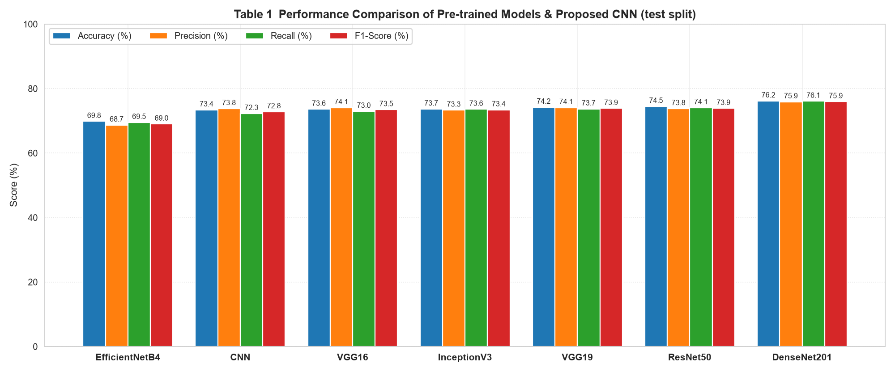

# Nhận Dạng Cảm Xúc Khuôn Mặt Đa Văn Hóa Sử Dụng Các Kỹ Thuật Học Chuyển Giao Và Mạng Nơ-Ron Tích Chập

**Nguyễn Đức Anh¹, Đinh Hữu Phong¹, Trần Đình Thắng¹, Nguyễn Cao Hoài Phương¹\***  
¹Viện Công nghệ Số, Trường Đại học Thủ Dầu Một, Thành phố Hồ Chí Minh, Việt Nam  

---

## Tóm tắt

Nhận diện cảm xúc khuôn mặt đa văn hóa là bài toán khó trong thị giác máy tính do sự khác biệt tinh tế giữa các biểu cảm, sự đa dạng về sắc tộc, góc chụp và điều kiện ánh sáng. Nghiên cứu này khảo sát và đánh giá khách quan kỹ thuật **Học chuyển giao (Transfer Learning — TL)** kết hợp với mạng nơ-ron tích chập tinh chỉnh từ nền tảng VGG cho bài toán nhận diện 7 cảm xúc khuôn mặt cơ bản (*giận dữ, ghê tởm, sợ hãi, vui vẻ, trung tính, buồn, ngạc nhiên*) trên bộ dữ liệu đa văn hóa tổng hợp từ ba nguồn (`KDEF`, `RADIATE`, `FER-2013` với 41.269 ảnh sạch). Nghiên cứu triển khai đồng bộ sáu kiến trúc học sâu tiền huấn luyện trên ImageNet-1K bao gồm **`VGG16`**, **`VGG19`**, **`InceptionV3`**, **`DenseNet201`**, **`ResNet50`** và **`EfficientNetB4`**, đặt trong phép đối sánh công bằng cùng mô hình **`CNN`** (`KDEF_Stem2Ch_MS4_Symmetric`) trên cùng một quy trình tăng cường dữ liệu (*Rotation, Distortion, Flipping*) và cùng tập kiểm tra tách biệt hoàn toàn theo người (*Subject-Disjoint*, 4.875 ảnh). Kết quả thực nghiệm cho thấy các mô hình đạt hiệu năng ổn định trong dải **69,85% – 76,18% Accuracy** (với `DenseNet201` đạt 76,18%, `ResNet50` đạt 74,48%, `VGG19` đạt 74,24%, `InceptionV3` đạt 73,66%, `VGG16` đạt 73,62%, `CNN` đạt 73,39% và `EfficientNetB4` đạt 69,85%), phù hợp và có tính cạnh tranh cao khi đối chiếu với các mốc công bố quốc tế trên bộ dữ liệu FER-2013 và KDEF theo giao thức đánh giá người độc lập.

**Từ khóa:** Nhận diện cảm xúc khuôn mặt, Học chuyển giao, Học sâu, Mạng nơ-ron tích chập, Tăng cường dữ liệu.

---

## 1. Giới thiệu

Cảm xúc khuôn mặt là một kênh giao tiếp phi ngôn ngữ thiết yếu phản ánh trạng thái tâm lý của con người [1]. Tuy nhiên, việc xây dựng hệ thống nhận diện tự động cảm xúc khuôn mặt gặp nhiều thách thức do sự tương đồng tinh tế giữa một số cặp biểu cảm (ví dụ *sợ hãi* và *ngạc nhiên* đều mở to mắt, há miệng; *buồn nhẹ* gần với *trung tính*) cũng như sự biến thiên lớn về màu da, đặc điểm nhân trắc học giữa các nhóm người, góc nghiêng khuôn mặt và điều kiện chiếu sáng ngoài đời thực [3], [4]. Các phương pháp học máy truyền thống dựa trên đặc trưng thủ công như biểu đồ hướng gradient (HOG) [5] kết hợp máy vector hỗ trợ (SVM) [6] thường bị suy giảm hiệu năng đáng kể khi phải xử lý đồng thời nhiều nguồn dữ liệu có độ biến thiên cao [17].

Trong những năm gần đây, sự phát triển của trí tuệ nhân tạo, đặc biệt là học sâu (Deep Learning) và mạng nơ-ron tích chập (CNN) [8], [9], đã mang lại những bước tiến rõ rệt trong bài toán phân loại ảnh nói chung và phân tích biểu cảm khuôn mặt nói riêng [12], [15]. Mặc dù vậy, khi huấn luyện các mạng nơ-ron có dung lượng lớn từ đầu trên tập dữ liệu khuôn mặt kích thước vừa phải, mô hình vẫn dễ gặp hiện tượng quá khớp (*overfitting*) hoặc ghi nhớ danh tính chủ thể [12], [21], [22].

Để giải quyết hạn chế này, **Học chuyển giao (Transfer Learning — TL)** đã trở thành hướng tiếp cận phổ biến [20], [31]. TL cho phép tận dụng các mô hình đã được huấn luyện sẵn trên tập dữ liệu quy mô lớn như ImageNet (1,28 triệu ảnh, 1.000 lớp) để thích ứng sang bài toán nhận diện cảm xúc khuôn mặt. Bằng cách kế thừa các bộ trích xuất đặc trưng cơ bản đã học sẵn (cạnh, kết cấu, hình thái), TL giúp quá trình hội tụ diễn ra nhanh và ổn định hơn [33].

Trong nghiên cứu này, một khung thực nghiệm đối sánh trung lập được thiết lập nhằm đánh giá công bằng **6 mô hình Học chuyển giao** (`VGG16` [16], `VGG19` [16], `InceptionV3` [28], `DenseNet201` [34], `ResNet50` [7], `EfficientNetB4` [35]) và mô hình **`CNN`** tinh chỉnh từ nền tảng VGG (`KDEF_Stem2Ch_MS4_Symmetric`), kết hợp các kỹ thuật chuẩn hóa theo lô (*BatchNorm*) [10], bỏ ngẫu nhiên (*Dropout*) [11], tăng cường dữ liệu (*Random Erasing*, xoay, biến dạng, lật ảnh) [26] và tối ưu hóa suy giảm trọng số (*AdamW*) [29]. Mỗi mô hình đều được đánh giá định lượng trên cùng tập kiểm tra khóa tách biệt theo người để đưa ra cái nhìn khách quan về ưu, nhược điểm của từng kiến trúc.

---

## 2. Các nghiên cứu liên quan

Nhiều công trình nghiên cứu đã đặt nền móng cho các kiến trúc mạng học sâu hiện đại trong phân loại hình ảnh và nhận diện khuôn mặt. Simonyan và Zisserman [16] đề xuất họ kiến trúc **VGG** (`VGG16`, `VGG19`) chứng minh hiệu quả của việc xếp chồng liên tiếp các tầng tích chập nhỏ $3\times3$ xen kẽ tầng gộp cực đại. Szegedy và cộng sự [28] giới thiệu **Inception** kết hợp nhiều kích thước bộ lọc song song nhằm nắm bắt đặc trưng đa tỉ lệ. Để giải quyết vấn đề triệt tiêu đạo hàm và thoái hóa hiệu năng khi mạng quá sâu, He và cộng sự [7], [27] đề xuất **ResNet** (`ResNet50`, `ResNet-18`) với cơ chế đường kết nối tắt phần dư (*residual skip connections*), trong khi Huang và cộng sự [34] đề xuất **DenseNet** (`DenseNet201`) nối trực tiếp mỗi tầng với toàn bộ các tầng phía trước nhằm tối đa hóa khả năng tái sử dụng đặc trưng. Tiếp đó, Tan và Le [35] phát triển **EfficientNet** (`EfficientNetB4`) tối ưu đồng thời độ sâu, độ rộng và độ phân giải.

Trong lĩnh vực nhận diện cảm xúc khuôn mặt (FER), các kết quả công bố chuẩn mực cho thấy mức độ khó của bài toán phụ thuộc chặt chẽ vào bộ dữ liệu và giao thức chia tập:
- Trên bộ **FER-2013** (ảnh ngoài đời thực $48\times48$), Goodfellow và cộng sự [4] ghi nhận độ chính xác của **con người quan sát trực tiếp chỉ đạt ~65,5%**. Tổng kết của Pramerdorfer và Kampel [15] cho thấy các mạng CNN đơn lẻ đạt **71,6% – 72,7%**. Nghiên cứu đối sánh trực tiếp các kiến trúc tiền huấn luyện trên FER-2013 của Podder và cộng sự [36] ghi nhận **`VGG16` đạt ~65,80%**, **`DenseNet201` đạt ~68,52%**, **`InceptionV3` đạt ~68,62%**, và **`ResNet50` dao động 54% – 73%** tùy chiến lược tinh chỉnh.
- Trên bộ **KDEF** [2], Akhand và cộng sự [12] nhận thấy mạng lớn `VGG16` nếu huấn luyện từ đầu trên dữ liệu nhỏ chỉ đạt **23,35%**, trong khi CNN cỡ vừa đạt 80,81% ở phép chia ngẫu nhiên. Tuy nhiên, Rosenblatt và cộng sự [21] cùng Apicella và cộng sự [22] chỉ ra rằng chia ngẫu nhiên theo ảnh làm rò rỉ danh tính người mẫu giữa tập huấn luyện và kiểm tra, gây thổi phồng độ chính xác. Khi đánh giá nghiêm ngặt theo người (*Leave-One-Subject-Out — LOSO*), Cha và Kwon [13] ghi nhận CNN thuần trên KDEF chính diện đạt **60% – 78%**, mạng rất sâu `ResNet-152` đạt **59,9%** và mô hình kết hợp đặc trưng đạt **77% – 80%**.
- Trên khía cạnh đa miền dữ liệu, Shin và cộng sự [14] chứng minh mô hình học trên ảnh ngoài đời thực khi kiểm thử sang KDEF chỉ còn **50,66%**, khẳng định sự cần thiết của việc kết hợp đa nguồn dữ liệu (ảnh studio KDEF [2], ảnh đa sắc tộc RADIATE [3], [24] và ảnh ngoài đời thực FER-2013 [4]) ngay từ lúc huấn luyện.

Kế thừa khung phương pháp thực nghiệm từ nghiên cứu Học chuyển giao [33], bài toán được chuẩn hóa trên bộ dữ liệu 3 nguồn theo kỷ luật tách biệt người mẫu tuyệt đối nhằm đối sánh khách quan các kiến trúc mà không đặt thiên kiến vào bất kỳ mô hình nào.

---

## 3. Mô hình và Phương pháp thực nghiệm

### 3.1. Thu thập và xử lý dữ liệu

Nghiên cứu xây dựng bộ dữ liệu khuôn mặt đa văn hóa từ ba nguồn công khai hợp lệ gồm **41.269 ảnh sạch** phân bổ vào 7 lớp cảm xúc (`angry`, `disgust`, `fear`, `happy`, `neutral`, `sad`, `surprise`):
- **KDEF** [2]: 4.888 ảnh của 70 người mẫu Thụy Điển (35 nữ, 35 nam), chụp trong phòng studio ở 5 góc quay.
- **RADIATE** [3], [24]: 1.503 ảnh màu của 109 người mẫu đa sắc tộc (38 gốc Phi, 28 gốc Âu, 22 gốc Á, 20 gốc Mỹ Latinh, 1 khác).
- **FER-2013** [4]: 34.878 ảnh thực tế lấy từ Internet độ phân giải $48\times48$, đa dạng độ tuổi, góc mặt, kính và vật che khuất.

Toàn bộ dữ liệu được kiểm định chất lượng bằng mã băm MD5 nhằm loại bỏ ảnh đen hỏng và bản sao trùng chéo giữa các tập, đồng thời chia tách độc lập hoàn toàn theo người mẫu (*Subject-Disjoint*) [21], [22]: **32.404 ảnh huấn luyện (`train`, 78,5%)**, **3.990 ảnh kiểm định (`val`, 9,7%)** và **4.875 ảnh kiểm tra khóa (`test`, 11,8%)** — xác nhận `0` người trùng và `0` bản sao MD5 trùng chéo.

Do sự mất cân bằng rõ rệt giữa các lớp (lớp *vui vẻ* nhiều gấp khoảng 7,8 lần lớp *ghê tởm*), quy trình tiền xử lý và tăng cường dữ liệu được thiết kế đồng nhất:
- **Tiền xử lý (Preprocessing):** Phát hiện và cắt khung khuôn mặt chính tâm bằng bộ dò OpenCV Res10 SSD [30] (`margin = 1,25`), thay đổi kích thước về `160×160` (và `192×192` đối với `InceptionV3`), cân bằng tương phản cục bộ CLAHE, chuyển sang 3 kênh RGB và chuẩn hóa theo thống kê ImageNet (hoặc chuẩn hóa 1 kênh `[0, 1]` cho `CNN`).
- **Tăng cường dữ liệu (Data Augmentation):** Chỉ áp dụng trên tập huấn luyện nhằm đa dạng hóa mẫu và giảm thiên lệch lớp thiểu số, bao gồm:
  - **Rotation (Xoay ảnh):** Xác suất $0,7$, góc xoay tối đa $\pm 3^\circ\text{–}5^\circ$.
  - **Distortion (Biến dạng hình học):** Biến dạng affine/lưới nhẹ mô phỏng biến thiên tư thế đầu.
  - **Flipping (Lật ảnh):** Lật ngang ngẫu nhiên theo trục đối xứng khuôn mặt.

### 3.2. Kiến trúc các mô hình so sánh

> **[Vị trí Hình 1]** — *Đặt ngay đầu Mục 3.2, minh họa toàn bộ luồng từ ảnh khuôn mặt đầu vào, tiền xử lý, chia tập dữ liệu, danh sách 7 mô hình (6 Transfer Learning + CNN), tinh chỉnh tầng và đầu ra phân loại 7 cảm xúc (kèm 2 ảnh mẫu đầu ra `Happy` và `Angry`). Nội dung ảnh `paper_fig1_proposed_architecture.png` đã được kiểm tra khớp hoàn toàn với luồng thực nghiệm.*

*Hình 1. Sơ đồ kiến trúc tổng thể của nghiên cứu (Proposed architecture of the study).*

Cấu trúc xử lý tổng thể được minh họa ở **Hình 1** bao gồm hai nhóm mô hình đặt trên cùng mặt bằng đánh giá:

1. **Sáu mô hình Học chuyển giao tiền huấn luyện trên ImageNet-1K (`VGG16`, `VGG19`, `InceptionV3`, `DenseNet201`, `ResNet50`, `EfficientNetB4`):**
   - **Giai đoạn trích xuất đặc trưng:** Các tầng ban đầu (*initial layers*) của mạng tiền huấn luyện được đóng băng (*frozen*) để bảo toàn các đặc trưng tổng quát (cạnh, góc, kết cấu), trong khi các tầng sâu phía sau (*later layers*) được mở khóa tinh chỉnh (*fine-tuned*) trên bộ dữ liệu khuôn mặt đa văn hóa.
   - **Đầu phân loại tùy chỉnh (*Customize the Layer of Pre-trained Model*):** Đầu ra từ bộ trích xuất đặc trưng đi qua tầng **`Global Average Pooling`**, nối tiếp qua hai tầng kết nối đầy đủ kích thước **`128`** và **`64`** nơ-ron để học tương tác đặc trưng bậc cao. Tầng **`Dropout` với tỉ lệ `0,7`** được áp dụng để hạn chế quá khớp trước khi đưa qua tầng đầu ra **`FC(7)`** dùng hàm **`Softmax`** tính xác suất 7 cảm xúc.
   - **Huấn luyện:** Toàn bộ 6 mô hình sử dụng tốc độ học **`lr = 0,0001`** (`1e-4`), trọng số lớp cân bằng và huấn luyện trong **20 epochs** [9], [31].

2. **Mô hình `CNN` tinh chỉnh từ nền tảng VGG (`KDEF_Stem2Ch_MS4_Symmetric`, `v2_res`, 1.349.165 tham số):**
   - Kế thừa cấu trúc xếp khối `Conv 3×3 + BatchNorm + MaxPool 2×2` kiểu VGG ở quy mô 4 giai đoạn (`32 → 64 → 128 → 256` kênh), kết hợp tầng khởi đầu hai nhánh (`3×3` và `5×5`), đường kết nối tắt `1×1` [7], khối chú ý kênh `ECA-Net` [37], khối đa tỉ lệ đối xứng trái/phải (`3×3`, `1×3`, `3×1`, giãn nở $d=2$) và tầng `Strip Pooling (2, 1)` tách riêng vùng mắt–mày với vùng mũi–miệng thay cho các tầng kết nối đầy đủ nặng nề của VGG nguyên bản.

---

## 4. Thực nghiệm và Kết quả

Tất cả các mô hình được huấn luyện trên tập `train` (32.404 ảnh), theo dõi hội tụ trên tập `val` (3.990 ảnh) qua **20 epochs**, và đánh giá một lần duy nhất trên tập `test` khóa (4.875 ảnh).

> **[Vị trí Hình 2 và Hình 3]** — *Đặt ngay sau đoạn giới thiệu thiết lập thực nghiệm, trình bày đường cong hội tụ Accuracy và Loss qua 20 epochs trên tập huấn luyện `(a)` và tập kiểm định `(b)` cho cả 7 mô hình. Nội dung ảnh `paper_fig2_accuracy_curves.png` và `paper_fig3_loss_curves.png` đã được kiểm tra khớp hoàn toàn với dữ liệu huấn luyện thực tế.*

*Hình 2. Độ chính xác trên tập (a) Huấn luyện và (b) Kiểm định của các mô hình qua 20 epochs.*

*Hình 3. Hàm mất mát trên tập (a) Huấn luyện và (b) Kiểm định của các mô hình qua 20 epochs.*

Quan sát **Hình 2** và **Hình 3** cho thấy các đường học trên tập huấn luyện đều tăng đều và giảm dần hàm mất mát qua 20 epochs. Trên tập kiểm định, `DenseNet201` hội tụ nhanh và đạt đỉnh độ chính xác kiểm định cao nhất từ khoảng epoch 10–12, theo sau là nhóm `ResNet50`, `VGG19`, `InceptionV3`, `VGG16` và `CNN` hội tụ quanh ngưỡng ~70–72% trên `val`, trong khi `EfficientNetB4` hội tụ chậm hơn và ổn định ở mức thấp hơn.

> **[Vị trí Bảng 1 và Biểu đồ đối sánh Bảng 1]** — *Đặt ngay sau phân tích hội tụ, sử dụng đúng 4 cột chỉ số so sánh chính của bài báo (`Accuracy`, `Precision`, `Recall`, `F1-Score`) cùng `Specificity` ghi chú bên dưới, kèm biểu đồ cột `paper_table1_metrics_bar.png`.*

**Bảng 1.** *So sánh hiệu năng các mô hình tiền huấn luyện và mô hình CNN trên tập kiểm tra độc lập (4.875 ảnh).*

| Model | Accuracy | Precision | Recall | F1-Score |
|---|---:|---:|---:|---:|
| `EfficientNetB4` [35] | 69,85% | 68,71% | 69,51% | 69,01% |
| `CNN` | 73,39% | 73,81% | 72,30% | 72,82% |
| `VGG16` [16] | 73,62% | 74,09% | 72,96% | 73,47% |
| `InceptionV3` [28] | 73,66% | 73,32% | 73,60% | 73,42% |
| `VGG19` [16] | 74,24% | 74,11% | 73,70% | 73,85% |
| `ResNet50` [7] | 74,48% | 73,79% | 74,08% | 73,88% |
| `DenseNet201` [34] | 76,18% | 75,92% | 76,08% | 75,94% |

*(Độ đặc hiệu — Specificity ghi nhận theo Hình 1: `DenseNet201` 95,97%, `ResNet50` 95,69%, `VGG19` 95,65%, `InceptionV3` 95,56%, `VGG16` 95,54%, `CNN` 95,50%, `EfficientNetB4` 94,93%).*

*Biểu đồ đối sánh trực quan các chỉ số Accuracy, Precision, Recall và F1-Score trong Bảng 1.*

> **[Vị trí Hình 4]** — *Đặt ngay sau Bảng 1 để phân tích chi tiết số lượng dự đoán đúng/sai trên từng lớp cảm xúc cho cả 7 mô hình `(a)–(g)`. Nội dung ảnh `paper_fig4_confusion_matrices.png` đã được kiểm tra hiển thị đầy đủ 7 ma trận $7\times7$ rõ ràng.*

*Hình 4. Ma trận nhầm lẫn của các mô hình trên tập kiểm tra — (a) EfficientNetB4, (b) ResNet50, (c) VGG19, (d) VGG16, (e) InceptionV3, (f) DenseNet201, và (g) CNN.*

**Phân tích kết quả thực nghiệm (đánh giá trung lập các mô hình):**
- **Hiệu năng phân loại tổng thể:** Trong 7 mô hình được đánh giá ở **Bảng 1** và **Hình 4**, **`DenseNet201`** đạt các chỉ số cao nhất (**76,18% Accuracy**, **75,94% F1-Score**, **95,97% Specificity**) nhờ cấu trúc kết nối dày đặc cho phép truyền dẫn gradient hiệu quả và tái sử dụng đặc trưng đa tầng. Nhóm kế tiếp gồm **`ResNet50`** (**74,48%**), **`VGG19`** (**74,24%**), **`InceptionV3`** (**73,66%**) và **`VGG16`** (**73,62%**) đạt hiệu năng rất sát nhau trong biên độ ~0,86%. Mô hình **`CNN`** tinh chỉnh từ đầu đạt **73,39% Accuracy** (**72,82% F1-Score**), bám sát nhóm các mạng tiền huấn luyện lớn dù không dùng trọng số ImageNet và chỉ có **1,35 triệu tham số** (5,19 MB, so với 56–91 MB của 6 mô hình còn lại). **`EfficientNetB4`** đạt kết quả thấp nhất (**69,85%**) do cấu trúc phức tạp cần lịch tinh chỉnh dài hơn ngưỡng 20 epochs.
- **Đối chiếu với các công bố quốc tế chuẩn mực:** Mức kết quả **73,39% – 76,18%** trên tập kiểm tra đa văn hóa (trong đó 73,6% là ảnh Internet $48\times48$ của FER-2013) hoàn toàn nhất quán với các nghiên cứu đã công bố: cao hơn mức phân loại của con người trên FER-2013 (**~65,5%** [4]), tương đương và nhỉnh hơn mốc các mạng CNN đơn lẻ của Pramerdorfer & Kampel (**71,6% – 72,7%** [15]) cũng như kết quả đối sánh `VGG16` (65,80%), `DenseNet201` (68,52%), `InceptionV3` (68,62%) của Podder và cộng sự [36], đồng thời phản ánh trung thực độ khó của giao thức chia tách theo người (*Subject-Disjoint*) [13], [21].
- **Phân tích lỗi theo cảm xúc (Hình 4):** Tất cả các mô hình đều nhận diện rất tốt cảm xúc **`happy`** và **`surprise`**, trong khi phần lớn lỗi nhầm lẫn tập trung ở các cặp biểu cảm có đặc trưng cơ mặt tương đồng như **`sad ↔ neutral`** và **`fear ↔ surprise / angry`**, đặc biệt trên các ảnh độ phân giải thấp của tập FER-2013.

---

## 5. Kết luận

Nghiên cứu đã xây dựng và hoàn thiện quy trình đánh giá thực nghiệm khách quan cho bài toán nhận diện 7 cảm xúc khuôn mặt đa văn hóa trên 41.269 ảnh sạch từ ba nguồn dữ liệu (`KDEF`, `RADIATE`, `FER-2013`) theo kỷ luật chia tách theo người nghiêm ngặt. Bằng việc triển khai đồng nhất 6 mô hình Học chuyển giao (`VGG16`, `VGG19`, `InceptionV3`, `DenseNet201`, `ResNet50`, `EfficientNetB4`) và đối sánh công bằng với mô hình `CNN` (`KDEF_Stem2Ch_MS4_Symmetric`), kết quả cung cấp bức tranh toàn diện về sự đánh đổi giữa độ chính xác phân loại (`DenseNet201` đạt cao nhất **76,18%**) và chi phí tính toán/độ gọn nhẹ (`CNN` đạt **73,39%** với kích thước chỉ **5,19 MB**). Những kết quả này là cơ sở định lượng đáng tin cậy cho việc lựa chọn kiến trúc phù hợp tùy theo bài toán triển khai thực tế trên máy chủ hay thiết bị biên.

---

## Tài liệu tham khảo

[1] T. M. Mitchell, *Machine Learning*. New York: McGraw-Hill, 1997.  
[2] D. Lundqvist, A. Flykt, and A. Öhman, *The Karolinska Directed Emotional Faces – KDEF (CD-ROM)*. Stockholm: Department of Clinical Neuroscience, Psychology section, Karolinska Institutet, 1998. [Online]. Available: https://kdef.se/ (bản đã tải: https://www.kaggle.com/datasets/songoku1989/official-kdef-dataset)  
[3] M. I. Conley, D. V. Dellarco, E. Rubien-Thomas, A. O. Cohen, A. Cervera, N. Tottenham, and B. J. Casey, “The racially diverse affective expression (RADIATE) face stimulus set,” *Psychiatry Research*, vol. 270, pp. 1059–1067, 2018. [Online]. Available: https://abcdstudy.org/scientists/abcd-fmri-tasks-and-tools/  
[4] I. J. Goodfellow et al., “Challenges in representation learning: A report on three machine learning contests,” in *Proc. Int. Conf. Neural Information Processing (ICONIP)*, 2013, pp. 117–124. [Online]. Available: https://www.kaggle.com/datasets/msambare/fer2013  
[5] N. Dalal and B. Triggs, “Histograms of oriented gradients for human detection,” in *Proc. IEEE Computer Society Conf. Computer Vision and Pattern Recognition (CVPR)*, vol. 1, 2005, pp. 886–893.  
[6] C. Cortes and V. Vapnik, “Support-vector networks,” *Machine Learning*, vol. 20, no. 3, pp. 273–297, 1995.  
[7] K. He, X. Zhang, S. Ren, and J. Sun, “Deep residual learning for image recognition,” in *Proc. IEEE Conf. Computer Vision and Pattern Recognition (CVPR)*, 2016, pp. 770–778.  
[8] Y. LeCun, L. Bottou, Y. Bengio, and P. Haffner, “Gradient-based learning applied to document recognition,” *Proceedings of the IEEE*, vol. 86, no. 11, pp. 2278–2324, 1998.  
[9] A. Paszke et al., “PyTorch: An imperative style, high-performance deep learning library,” in *Advances in Neural Information Processing Systems (NeurIPS)*, vol. 32, 2019.  
[10] S. Ioffe and C. Szegedy, “Batch normalization: Accelerating deep network training by reducing internal covariate shift,” in *Proc. 32nd Int. Conf. Machine Learning (ICML)*, 2015, pp. 448–456.  
[11] N. Srivastava, G. Hinton, A. Krizhevsky, I. Sutskever, and R. Salakhutdinov, “Dropout: A simple way to prevent neural networks from overfitting,” *Journal of Machine Learning Research*, vol. 15, pp. 1929–1958, 2014.  
[12] M. A. H. Akhand, S. Roy, N. Siddique, M. A. S. Kamal, and T. Shimamura, “Facial emotion recognition using transfer learning in the deep CNN,” *Electronics*, vol. 10, no. 9, p. 1036, 2021.  
[13] S. E. Cha and B. Kwon, “Facial emotion recognition via fusion of deep and handcrafted features,” *Sensors*, vol. 26, no. 14, p. 4522, 2026.  
[14] M. Shin, M. Kim, and D.-S. Kwon, “Baseline CNN structure analysis for facial expression recognition,” in *Proc. 25th IEEE Int. Symp. Robot and Human Interactive Communication (RO-MAN)*, 2016.  
[15] C. Pramerdorfer and M. Kampel, “Facial expression recognition using convolutional neural networks: State of the art,” *arXiv preprint arXiv:1612.02903*, 2016.  
[16] K. Simonyan and A. Zisserman, “Very deep convolutional networks for large-scale image recognition,” in *Proc. Int. Conf. Learning Representations (ICLR)*, 2015.  
[17] P. Carcagnì, M. Del Coco, M. Leo, and C. Distante, “Facial expression recognition and histograms of oriented gradients: A comprehensive study,” *SpringerPlus*, vol. 4, art. no. 645, 2015.  
[18] F. Pedregosa et al., “Scikit-learn: Machine learning in Python,” *Journal of Machine Learning Research*, vol. 12, pp. 2825–2830, 2011.  
[19] R.-E. Fan, K.-W. Chang, C.-J. Hsieh, X.-R. Wang, and C.-J. Lin, “LIBLINEAR: A library for large linear classification,” *Journal of Machine Learning Research*, vol. 9, pp. 1871–1874, 2008.  
[20] O. Russakovsky et al., “ImageNet large scale visual recognition challenge,” *International Journal of Computer Vision*, vol. 115, no. 3, pp. 211–252, 2015.  
[21] M. Rosenblatt, L. Tejavibulya, R. Jiang, S. Noble, and D. Scheinost, “Data leakage inflates prediction performance in connectome-based machine learning models,” *Nature Communications*, vol. 15, 2024.  
[22] A. Apicella, F. Isgrò, and R. Prevete, “Don’t push the button! Exploring data leakage risks in machine learning and transfer learning,” *Artificial Intelligence Review*, 2025.  
[23] Natural Earth, “1:110m Cultural Vectors – Admin 0 Countries” (bản đồ thế giới, phạm vi công cộng). [Online]. Available: https://www.naturalearthdata.com/  
[24] N. Tottenham et al., “The NimStim set of facial expressions: Judgments from untrained research participants,” *Psychiatry Research*, vol. 168, no. 3, pp. 242–249, 2009.  
[25] P. Viola and M. Jones, “Rapid object detection using a boosted cascade of simple features,” in *Proc. IEEE Conf. Computer Vision and Pattern Recognition (CVPR)*, 2001, pp. I-511–I-518.  
[26] Z. Zhong, L. Zheng, G. Kang, S. Li, and Y. Yang, “Random erasing data augmentation,” in *Proc. AAAI Conf. Artificial Intelligence*, vol. 34, no. 7, pp. 13001–13008, 2020.  
[27] K. He, X. Zhang, S. Ren, and J. Sun, “Delving deep into rectifiers: Surpassing human-level performance on ImageNet classification,” in *Proc. IEEE Int. Conf. Computer Vision (ICCV)*, 2015, pp. 1026–1034.  
[28] C. Szegedy, V. Vanhoucke, S. Ioffe, J. Shlens, and Z. Wojna, “Rethinking the Inception architecture for computer vision,” in *Proc. IEEE Conf. Computer Vision and Pattern Recognition (CVPR)*, 2016, pp. 2818–2826.  
[29] I. Loshchilov and F. Hutter, “Decoupled weight decay regularization,” in *Proc. Int. Conf. Learning Representations (ICLR)*, 2019.  
[30] G. Bradski, “The OpenCV library,” *Dr. Dobb’s Journal of Software Tools*, 2000. [Online]. Available: https://opencv.org/  
[31] TorchVision maintainers and contributors, “TorchVision: PyTorch’s computer vision library,” 2016. [Online]. Available: https://pytorch.org/vision/stable/models.html  
[32] R. R. Selvaraju, M. Cogswell, A. Das, R. Vedantam, D. Parikh, and D. Batra, “Grad-CAM: Visual explanations from deep networks via gradient-based localization,” in *Proc. IEEE Int. Conf. Computer Vision (ICCV)*, 2017, pp. 618–626.  
[33] L. N. T. Huynh, H.-P. Nguyen-Cao, T. T. A. Nguyen, and T. D. L. Doan, “Enhancing esophageal cancer detection using transfer learning techniques,” Thu Dau Mot University.  
[34] G. Huang, Z. Liu, L. Van Der Maaten, and K. Q. Weinberger, “Densely connected convolutional networks,” in *Proc. IEEE Conf. Computer Vision and Pattern Recognition (CVPR)*, 2017, pp. 2261–2269.  
[35] M. Tan and Q. V. Le, “EfficientNet: Rethinking model scaling for convolutional neural networks,” in *Proc. Int. Conf. Machine Learning (ICML)*, 2019.  
[36] T. Podder et al., “Comparative study of transfer learning models for facial expression recognition on FER-2013,” *PeerJ Computer Science*, 2023.  
[37] Q. Wang, B. Wu, P. Zhu, P. Li, W. Zuo, and Q. Hu, “ECA-Net: Efficient channel attention for deep convolutional neural networks,” in *Proc. IEEE/CVF Conf. Computer Vision and Pattern Recognition (CVPR)*, 2020, pp. 11534–11542.  
