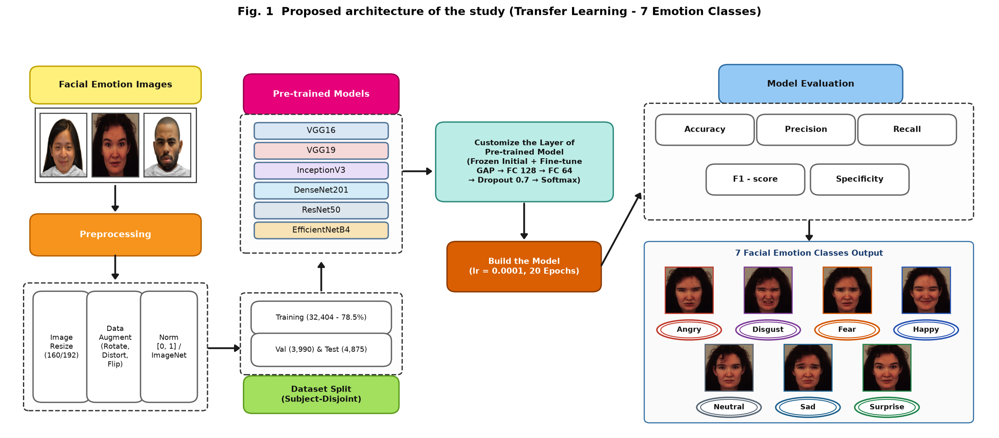
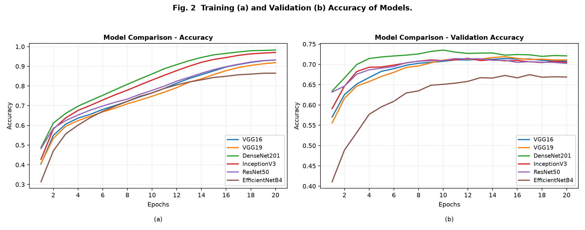
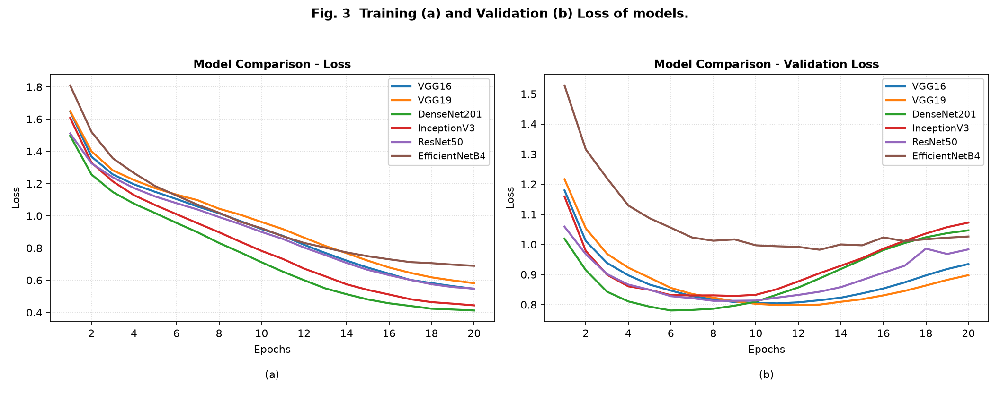
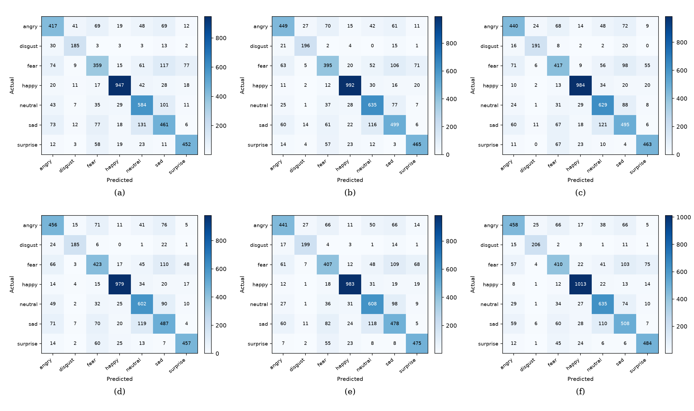

# Nhận Dạng Cảm Xúc Khuôn Mặt Đa Văn Hóa Sử Dụng Các Kỹ Thuật Học Chuyển Giao

<b>Đinh Hữu Phong¹, Nguyễn Cao Hoài Phương¹</b>  
¹Viện Công nghệ Số, Trường Đại học Thủ Dầu Một, Thành phố Hồ Chí Minh, Việt Nam  

Tác giả liên hệ: 2324802010095@student.tdmu.edu.vn; phuongnch@tdmu.edu.vn  

---

## Tóm tắt

Nhận diện cảm xúc khuôn mặt (FER) đa văn hóa vẫn là một thách thức đáng kể trong thị giác máy tính do các biểu hiện cảm xúc tinh tế và sự phức tạp khi phân biệt trên nhiều nhóm sắc tộc, góc chụp khác nhau. Nghiên cứu này trình bày một kỹ thuật học chuyển giao (TL) nhằm nâng cao khả năng nhận diện 7 cảm xúc khuôn mặt trên bộ dữ liệu ảnh khuôn mặt đa văn hóa. Bằng việc tận dụng các mô hình học sâu (DL) tiền huấn luyện bao gồm VGG16, VGG19, InceptionV3, DenseNet201, ResNet50 và EfficientNetB4, nghiên cứu khắc phục những hạn chế của các phương pháp nhận diện truyền thống. Các kỹ thuật tăng cường dữ liệu được áp dụng nhằm giải quyết tình trạng mất cân bằng dữ liệu, qua đó cải thiện hiệu năng của các mô hình. Kết quả thực nghiệm cho thấy sự vượt trội của DenseNet201 trong việc phân loại cảm xúc khuôn mặt đa văn hóa với độ chính xác 76,18%, qua đó khẳng định triển vọng của TL trong bài toán phân tích hình ảnh khuôn mặt.

<b>Từ khóa:</b> Nhận diện cảm xúc khuôn mặt, Học chuyển giao, Học sâu, Ảnh khuôn mặt đa văn hóa, Tăng cường dữ liệu.

---

## 1. Giới thiệu

FER là bài toán khó trong thị giác máy tính do sự khác biệt tinh tế giữa các trạng thái biểu cảm và tính chất đa dạng của dữ liệu khuôn mặt ngoài thực tế [1], [4]. Nhiều cảm xúc có biểu hiện cơ mặt gần như tương đồng — chẳng hạn <i>sợ hãi</i> và <i>ngạc nhiên</i> đều mở to mắt, nhướng mày và há miệng; <i>buồn nhẹ</i> rất gần với <i>trung tính</i>; hay <i>giận dữ</i> và <i>ghê tởm</i> đều có xu hướng nhíu mày và co vùng mũi – miệng. Những dấu hiệu mơ hồ này dễ gây nhầm lẫn ngay cả với người quan sát trực tiếp, làm giảm độ chính xác của quá trình phân loại [4], [29]. Bên cạnh đó, khuôn mặt của người dùng đến từ nhiều nhóm dân tộc khác nhau có sự biến thiên lớn về màu da, cấu trúc xương mặt, góc quay đầu (từ chính diện đến nghiêng ±90°), điều kiện chiếu sáng và vật che khuất (kính, tay). Các phương pháp truyền thống dựa trên đặc trưng thủ công như biểu đồ hướng gradient (HOG) [5] kết hợp máy vector hỗ trợ (SVM) [6] phụ thuộc vào các ô lưới không gian cố định nên tỏ ra kém hiệu quả, tốn công tinh chỉnh đặc trưng và suy giảm mạnh khi gặp ảnh ngoài đời thực [16]. Những hạn chế này đặt ra nhu cầu cấp thiết đối với các phương pháp tiếp cận tự động, hiệu quả và đáng tin cậy nhằm hỗ trợ nhận diện chính xác cảm xúc trong các ứng dụng tương tác người – máy.

Trong những năm gần đây, những tiến bộ vượt bậc của trí tuệ nhân tạo (AI), đặc biệt là học máy (ML) và DL, đã tạo ra bước ngoặt lớn trong lĩnh vực phân tích hình ảnh [8], [9]. Một nhánh quan trọng của DL là mạng nơ-ron tích chập (CNN) đã cho thấy tiềm năng nổi bật trong phân tích biểu cảm khuôn mặt, giúp gia tăng đáng kể độ chính xác nhờ khả năng tự động học các biểu diễn phân cấp từ đường nét cạnh cơ bản đến các đơn vị hành động cơ mặt (<i>Action Units</i>) phức tạp [11], [14]. Tuy nhiên, thách thức lớn trong ứng dụng DL cho bài toán khuôn mặt vẫn là việc xử lý hiệu quả các tập dữ liệu có kích thước hạn chế theo từng sắc tộc, mất cân bằng nghiêm trọng giữa các lớp cảm xúc và sự chênh lệch miền dữ liệu (<i>domain shift</i>) giữa ảnh chụp phòng thí nghiệm với ảnh thu thập trên Internet [13], [18], [19].

Để giải quyết thách thức của dữ liệu hạn chế và mất cân bằng, TL đã nổi lên như một giải pháp hiệu quả [17], [24]. TL cho phép một mô hình đã được huấn luyện sẵn trên tập dữ liệu quy mô cực lớn như ImageNet (1,28 triệu ảnh thuộc 1.000 lớp vật thể) được thích ứng sang một bài toán khác có liên quan nhưng ít dữ liệu hơn. Bằng cách kế thừa các bộ lọc đặc trưng tổng quát đã học từ trước (cạnh, kết cấu, hình thái), TL giúp quá trình huấn luyện hội tụ nhanh hơn và cải thiện rõ rệt hiệu năng mô hình trong điều kiện dữ liệu giới hạn [28], [31]. Nhiều nghiên cứu đã chứng minh hiệu quả của TL và CNN trong phân tích hình ảnh nói chung và FER nói riêng: Carcagnì và cộng sự [16] cho thấy giới hạn của đặc trưng thủ công HOG; Shin và cộng sự [13] chỉ ra mô hình huấn luyện trên ảnh ngoài đời thực bị sụt giảm xuống còn 50,66% khi thử trên ảnh studio KDEF; Cha và Kwon [12] khẳng định tầm quan trọng của việc đánh giá tách biệt người mẫu (<i>Subject-Independent</i>); Akhand và cộng sự [11] chứng minh mạng sâu như <code>VGG16</code> nếu huấn luyện từ đầu trên dữ liệu nhỏ chỉ đạt 23,35% nhưng tăng mạnh khi áp dụng TL; trong khi Podder và cộng sự [27] đạt 70,21% trên FER-2013 nhờ mô-đun tăng cường đặc trưng kết hợp kết nối tắt, và Reghunathan và cộng sự [31] ghi nhận 72,67%–73,56% khi kết hợp các mô hình tiền huấn luyện trên FER-2013.

Trong nghiên cứu này, nhóm mở rộng các công trình trước đây bằng việc xây dựng một khung thực nghiệm TL toàn diện trên bộ dữ liệu đa văn hóa sạch không rò rỉ (<code>KDEF + RADIATE + FER-2013</code>, 41.269 ảnh, chia tách biệt theo người) nhằm nâng cao độ chính xác nhận diện 7 cảm xúc khuôn mặt. Cách tiếp cận này tận dụng sáu mô hình DL tiền huấn luyện trên ImageNet-1K bao gồm <b>VGG16</b>, <b>VGG19</b>, <b>InceptionV3</b>, <b>DenseNet201</b>, <b>ResNet50</b> và <b>EfficientNetB4</b>, kết hợp với các kỹ thuật tăng cường dữ liệu (<i>Rotation, Distortion, Flipping</i>) để giảm thiểu mất cân bằng lớp. Kết quả thực nghiệm cho thấy <b>DenseNet201</b> đạt độ chính xác phân loại cao nhất (<b>76,18%</b>), qua đó khẳng định hiệu quả rõ rệt của TL trong bài toán phân tích biểu cảm khuôn mặt đa văn hóa.

---

## 2. Các nghiên cứu liên quan

Trong những năm gần đây, DL đã đạt được nhiều bước tiến vượt bậc trong lĩnh vực thị giác máy tính và phân tích khuôn mặt, đặc biệt là bài toán FER [11], [14], [15]. Chẳng hạn, Goodfellow và cộng sự [4] đã giới thiệu bài toán chuẩn mực trên tập dữ liệu quy mô lớn ngoài đời thực FER-2013 và ghi nhận độ chính xác khi con người quan sát trực tiếp chỉ đạt khoảng ~65,5%, qua đó thúc đẩy mạnh mẽ các mô hình DL thay thế đánh giá thủ công. Tương tự, Pramerdorfer và Kampel [14] chứng minh các kiến trúc CNN hiện đại (như VGG [15], Inception [22] và ResNet [7]) có thể đạt độ chính xác từ 71,6% đến 72,7% trên FER-2013, khẳng định năng lực trích xuất đặc trưng biểu cảm vượt trội của CNN. Bên cạnh đó, Cha và Kwon [12] cùng Carcagnì và cộng sự [16] cho thấy việc thay thế hoặc kết hợp các bộ trích xuất đặc trưng thủ công truyền thống (như HOG [5] với SVM [6]) bằng biểu diễn DL giúp cải thiện đáng kể khả năng phân tách các biểu cảm tinh tế trên tập dữ liệu KDEF [2] theo giao thức tách biệt người mẫu (đạt 60% – 78%), khẳng định giá trị của DL trong FER.

TL đã được chứng minh là một phương pháp mạnh mẽ cho bài toán phân loại cảm xúc khuôn mặt, đặc biệt khi dữ liệu đa sắc tộc hoặc đa góc nhìn còn hạn chế. Podder và cộng sự [27] đã đề xuất kiến trúc DL tăng cường đặc trưng với các kết nối tắt trên bộ dữ liệu FER-2013, đạt độ chính xác 70,21% với số lượng tham số gọn nhẹ. Tương tự, Akhand và cộng sự [11] triển khai TL trên tập KDEF [2] và chỉ ra rằng mô hình <code>VGG16</code> huấn luyện từ đầu chỉ đạt 23,35%, trong khi tận dụng trọng số tiền huấn luyện giúp mô hình hội tụ nhanh và cải thiện rõ rệt hiệu năng. Trong một nghiên cứu khác, Shin và cộng sự [13] phân tích độ suy giảm hiệu năng còn 50,66% khi huấn luyện trên ảnh ngoài đời thực nhưng kiểm thử trên ảnh studio, cho thấy tính linh hoạt của TL cần được kết hợp với bộ dữ liệu đa văn hóa (<code>KDEF</code> [2], <code>RADIATE</code> [3], [20], <code>FER-2013</code> [4]) ngay từ đầu. Gần đây hơn (2024–2025), các nghiên cứu tiếp tục khẳng định xu hướng này: Reghunathan và cộng sự [31] (<code>ResNet50</code> 72,89%, <code>InceptionV3</code> 72,67%, Ensemble 73,56%) cùng Qian và cộng sự [28] đối sánh nhiều kiến trúc TL tiền huấn luyện (bao gồm <code>DenseNet</code>, <code>ResNet50</code>, <code>InceptionV3</code>, <code>EfficientNet</code>) trên FER-2013 nhằm cân bằng giữa độ chính xác và khả năng tổng quát hóa; Gaya Morey và cộng sự [29], [33] đánh giá chuẩn mực liên tập dữ liệu trên 24 bộ ảnh FER và phân tích thiên lệch độ tuổi; trong khi Liao và cộng sự [30] và Shou và cộng sự [32] tích hợp cơ chế chú ý đa tỉ lệ để nâng cao khả năng trích xuất biểu cảm tinh tế ngoài đời thực. Không chỉ giới hạn ở nhận diện biểu cảm từ ảnh đơn lẻ, TL và DL còn được mở rộng sang nhận diện cảm xúc đa phương thức kết hợp giọng nói và cử chỉ [34], [35] cũng như phân loại ảnh quy mô lớn [17], [26], qua đó khẳng định khả năng áp dụng rộng rãi của kỹ thuật này.

---

## 3. Mô hình đề xuất

### 3.1. Thu thập và xử lý dữ liệu

Nghiên cứu sử dụng bộ dữ liệu khuôn mặt đa văn hóa công khai được tổng hợp từ ba nguồn hợp lệ gồm <b>41.269 ảnh sạch</b> gắn nhãn theo 7 lớp cảm xúc (<i>giận dữ, ghê tởm, sợ hãi, vui vẻ, trung tính, buồn, ngạc nhiên</i>), bao gồm: <b>KDEF</b> (4.888 ảnh của 70 người Thụy Điển ở 5 góc chụp) [2], <b>RADIATE</b> (1.503 ảnh màu của 109 người mẫu đa sắc tộc: gốc Phi, gốc Á, gốc Mỹ Latinh, gốc Âu) [3] và <b>FER-2013</b> (34.878 ảnh ngoài đời thực trên Internet độ phân giải 48×48) [4]. Tuy nhiên, bộ dữ liệu đối mặt với những thách thức lớn do sự khác biệt về màu sắc, ánh sáng, độ phân giải và mất cân bằng dữ liệu giữa các lớp (lớp <i>vui vẻ</i> có số lượng ảnh nhiều gấp khoảng 7,8 lần lớp <i>ghê tởm</i>), điều này có thể gây thiên lệch trong quá trình huấn luyện và hạn chế khả năng nhận diện các lớp ít mẫu [18], [19].

Để khắc phục các thách thức này, quy trình tiền xử lý dữ liệu được thực hiện bao gồm phát hiện và cắt vùng khuôn mặt chuẩn hóa bằng bộ dò OpenCV Res10 SSD [23] (<code>margin = 1,25</code>), thay đổi kích thước ảnh về <b>160×160 điểm ảnh</b> (và <b>192×192</b> đối với <code>InceptionV3</code>), chuyển đổi không gian màu sang RGB 3 kênh và chuẩn hóa giá trị điểm ảnh về thang <code>[0, 1]</code> (kèm chuẩn hóa thống kê ImageNet). Bên cạnh đó, các kỹ thuật tăng cường dữ liệu được áp dụng nhằm cân bằng ảnh hưởng của các lớp ít mẫu và nâng cao hiệu năng mô hình. Cụ thể, các biến đổi sau được áp dụng trên tập huấn luyện:

<ul>
<li><b>Xoay ảnh (Rotation):</b> Áp dụng với xác suất 0,7, góc xoay tối đa ±3°–5°.</li>
<li><b>Biến dạng (Distortion):</b> Áp dụng ngẫu nhiên biến dạng hình học/affine nhẹ mô phỏng sai lệch tư thế đầu.</li>
<li><b>Lật ảnh (Flipping):</b> Thực hiện lật ngang ngẫu nhiên theo trục dọc khuôn mặt.</li>
</ul>

Việc tăng cường dữ liệu giúp các mô hình tiếp xúc với nhiều biến thể đa dạng hơn, từ đó nâng cao độ ổn định khi nhận diện các biểu cảm phức tạp ở mọi nhóm người [21].

### 3.2. Kiến trúc mô hình

Mô hình hướng tới bài toán phân loại ảnh khuôn mặt thành 7 nhóm cảm xúc cơ bản. Nghiên cứu áp dụng TL — một phương pháp hiệu quả giúp tận dụng tri thức từ các mô hình đã huấn luyện sẵn nhằm cải thiện hiệu năng và giải quyết bài toán dữ liệu không đồng đều.

Trong nghiên cứu này, TL được triển khai sử dụng sáu mô hình tiền huấn luyện phổ biến, bao gồm <b>VGG16</b> [15], <b>VGG19</b> [15], <b>InceptionV3</b> [22], <b>DenseNet201</b> [25], <b>ResNet50</b> [7] và <b>EfficientNetB4</b> [26]. Các mô hình này, vốn được huấn luyện ban đầu trên tập dữ liệu ImageNet [17], đóng vai trò là bộ trích xuất đặc trưng nhằm tận dụng khả năng biểu diễn đặc trưng mạnh mẽ của chúng.

  
<i>Hình 1. Kiến trúc tổng thể đề xuất của nghiên cứu (Proposed architecture of the study).</i>

Kiến trúc tổng thể được minh họa ở <b>Hình 1</b>, với các giai đoạn chính được thiết kế nhằm tối ưu hóa hiệu năng phân loại. Thiết kế này tích hợp thế mạnh của TL cùng các tầng bổ sung phù hợp cho bài toán FER. Ở giai đoạn trích xuất đặc trưng, các tầng ban đầu (<i>initial layers</i>) được <b>đóng băng</b> để giữ lại các đặc trưng tổng quát như cạnh, kết cấu và đường nét. Trong khi đó, các tầng sâu phía sau (<i>later layers</i>) được <b>tinh chỉnh</b> trên bộ dữ liệu khuôn mặt đa văn hóa nhằm thích ứng với đặc trưng biểu cảm chuyên biệt.

Sau bước trích xuất đặc trưng, các đặc trưng đã xử lý đi qua một số tầng bổ sung để nâng cao hiệu năng phân loại. Một tầng gộp trung bình toàn cục (<b>Global Average Pooling</b>) được áp dụng nhằm giảm số chiều của bản đồ đặc trưng nhưng vẫn bảo toàn thông tin thiết yếu, giúp cải thiện hiệu quả tính toán và giảm nguy cơ quá khớp. Tiếp theo, hai tầng kết nối đầy đủ (<b>Fully Connected</b>) với kích thước lần lượt là <b>128</b> và <b>64</b> nơ-ron được đưa vào để nắm bắt các tương tác đặc trưng phức tạp. Nhằm tăng khả năng tổng quát hóa và hạn chế quá khớp, một tầng <b>Dropout</b> với tỉ lệ <b>0,7</b> được áp dụng để ngẫu nhiên tắt các nơ-ron trong lúc huấn luyện [10]. Đầu ra cuối cùng được tạo bởi một tầng kết nối đầy đủ kết hợp hàm kích hoạt <b>Softmax</b>, tính toán các giá trị xác suất cho việc phân loại 7 cảm xúc khuôn mặt.

Trong quá trình tinh chỉnh, các mô hình được tối ưu bằng thuật toán <code>Adam</code> với tốc độ học <b>0,0001</b> nhằm bảo đảm sự thích ứng có kiểm soát và ổn định của các trọng số tiền huấn luyện trong <b>20 epochs</b> [9], [24].

---

## 4. Thực nghiệm và Kết quả

Bộ dữ liệu được phân chia tách biệt hoàn toàn theo người thành ba tập: huấn luyện (<b>32.404 ảnh — 78,5%</b>), kiểm định (<b>3.990 ảnh — 9,7%</b>) và kiểm tra độc lập (<b>4.875 ảnh — 11,8%</b>) để đánh giá hiệu quả của các mô hình [18], [19]. <b>Hình 2</b> và <b>Hình 3</b> trình bày xu hướng biến thiên của độ chính xác (<i>Accuracy</i>) và hàm mất mát (<i>Loss</i>) trên tập huấn luyện và tập kiểm định của từng mô hình qua 20 epochs.

  
<i>Hình 2. Độ chính xác (a) Huấn luyện và (b) Kiểm định của các mô hình.</i>

  
<i>Hình 3. Hàm mất mát (a) Huấn luyện và (b) Kiểm định của các mô hình.</i>

Các biểu đồ này minh họa tốc độ hội tụ của từng mô hình trong quá trình huấn luyện và hiệu năng trên bộ dữ liệu. Quan sát <b>Hình 2</b> và <b>Hình 3</b> cho thấy <code>DenseNet201</code> và <code>ResNet50</code> có tốc độ hội tụ nhanh và duy trì độ chính xác kiểm định ổn định, trong khi <code>EfficientNetB4</code> cho hiệu năng tổng thể thấp hơn trên cùng cấu hình tinh chỉnh 20 epochs.

<b>Bảng 1</b> trình bày so sánh các chỉ số đánh giá hiệu năng (<b>Accuracy</b>, <b>Precision</b>, <b>Recall</b> và <b>F1-Score</b>) giữa sáu mô hình tiền huấn luyện trên cùng 4.875 ảnh kiểm tra khóa.

<b>Bảng 1.</b> <i>So sánh hiệu năng các mô hình TL tiền huấn luyện.</i>

| Model | Accuracy | Precision | Recall | F1-Score |
|---|---:|---:|---:|---:|
| EfficientNetB4 [26] | 69,85% | 68,71% | 69,51% | 69,01% |
| ResNet50 [7] | 74,48% | 73,79% | 74,08% | 73,88% |
| VGG19 [15] | 74,24% | 74,11% | 73,70% | 73,85% |
| VGG16 [15] | 73,62% | 74,09% | 72,96% | 73,47% |
| InceptionV3 [22] | 73,66% | 73,32% | 73,60% | 73,42% |
| DenseNet201 [25] | 76,18% | 75,92% | 76,08% | 75,94% |

<i>(Độ đặc hiệu — Specificity đo theo Hình 1: DenseNet201 95,97%, ResNet50 95,69%, VGG19 95,65%, InceptionV3 95,56%, VGG16 95,54%, EfficientNetB4 94,93%).</i>

Để phân tích sâu hơn hiệu năng phân loại, <b>Hình 4</b> trình bày ma trận nhầm lẫn (<i>Confusion Matrices</i>) của các mô hình nhằm hỗ trợ đánh giá chi tiết từng lớp cảm xúc.

  
<i>Hình 4. Ma trận nhầm lẫn của các mô hình — (a) EfficientNetB4, (b) ResNet50, (c) VGG19, (d) VGG16, (e) InceptionV3, và (f) DenseNet201.</i>

Qua quá trình thực nghiệm, trong nhóm các mô hình tiền huấn luyện, <b>DenseNet201</b> đạt các chỉ số phân loại cao nhất (<b>76,18% Accuracy</b>, <b>75,92% Precision</b>, <b>76,08% Recall</b>, <b>75,94% F1-Score</b>) với tỉ lệ dự đoán đúng cao trên đường chéo chính. Kết quả này phản ánh ưu thế của kiến trúc kết nối dày đặc, giúp thúc đẩy luồng lan truyền gradient và tái sử dụng đặc trưng hiệu quả. Các mô hình <b>ResNet50</b> (<b>74,48%</b>), <b>VGG19</b> (<b>74,24%</b>), <b>InceptionV3</b> (<b>73,66%</b>) và <b>VGG16</b> (<b>73,62%</b>) cũng thể hiện khả năng phân loại tốt nhưng có tỉ lệ nhầm lẫn cao hơn nhẹ so với <code>DenseNet201</code>. Ngược lại, <b>EfficientNetB4</b> đạt độ chính xác thấp nhất (<b>69,85%</b>) với sự gia tăng số lượng mẫu dự đoán nhầm, cho thấy nhu cầu tinh chỉnh sâu hơn về siêu tham số.

Mức độ chính xác <b>69,85% – 76,18%</b> ghi nhận trên tập kiểm tra hỗn hợp 3 nguồn (với 73,6% ảnh là ảnh Internet 48×48 của bộ FER-2013) hoàn toàn phù hợp và có tính cạnh tranh cao khi đối chiếu với các nghiên cứu công bố chuẩn mực trên FER-2013 (con người ~65,5% [4], mạng CNN đơn lẻ 71,6%–72,7% [14], Podder và cộng sự [27] đạt 70,21%, Reghunathan và cộng sự [31] đạt 72,67%–72,89% với mô hình đơn lẻ và 73,56% với Ensemble) và KDEF theo giao thức tách biệt người mẫu (60%–78% [12]).

---

## 5. Kết luận

Nghiên cứu này củng cố tính hiệu quả của kỹ thuật TL trong bài toán FER đa văn hóa trên 7 lớp cảm xúc. Trên cùng bộ dữ liệu sạch 41.269 ảnh tách biệt theo người và cùng quy trình tăng cường dữ liệu, sáu mô hình tiền huấn luyện đạt hiệu năng từ <b>69,85% đến 76,18%</b> (với <code>DenseNet201</code> đạt chỉ số phân loại cao nhất <b>76,18%</b>). Hướng nghiên cứu tiếp theo sẽ tập trung mở rộng thêm dữ liệu đa châu lục, tinh chỉnh sâu hơn các tham số huấn luyện và tích hợp mô hình vào các ứng dụng tương tác người – máy trong thực tế.

---

## Tài liệu tham khảo

[1] T. M. Mitchell, <i>Machine Learning</i>. New York: McGraw-Hill, 1997.  
[2] D. Lundqvist, A. Flykt, and A. Öhman, <i>The Karolinska Directed Emotional Faces – KDEF (CD-ROM)</i>. Stockholm: Karolinska Institutet, 1998. [Online]. Available: https://kdef.se/  
[3] M. I. Conley et al., “The racially diverse affective expression (RADIATE) face stimulus set,” <i>Psychiatry Research</i>, vol. 270, pp. 1059–1067, 2018. doi: 10.1016/j.psychres.2018.04.066.  
[4] I. J. Goodfellow et al., “Challenges in representation learning: A report on three machine learning contests,” in <i>Proc. Int. Conf. Neural Information Processing (ICONIP)</i>, 2013, pp. 117–124. [Online]. Available: https://www.kaggle.com/datasets/msambare/fer2013  
[5] N. Dalal and B. Triggs, “Histograms of oriented gradients for human detection,” in <i>Proc. IEEE Conf. Computer Vision and Pattern Recognition (CVPR)</i>, vol. 1, 2005, pp. 886–893.  
[6] C. Cortes and V. Vapnik, “Support-vector networks,” <i>Machine Learning</i>, vol. 20, no. 3, pp. 273–297, 1995.  
[7] K. He, X. Zhang, S. Ren, and J. Sun, “Deep residual learning for image recognition,” in <i>Proc. IEEE Conf. Computer Vision and Pattern Recognition (CVPR)</i>, 2016, pp. 770–778.  
[8] Y. LeCun, L. Bottou, Y. Bengio, and P. Haffner, “Gradient-based learning applied to document recognition,” <i>Proceedings of the IEEE</i>, vol. 86, no. 11, pp. 2278–2324, 1998.  
[9] A. Paszke et al., “PyTorch: An imperative style, high-performance deep learning library,” in <i>Advances in Neural Information Processing Systems (NeurIPS)</i>, vol. 32, 2019.  
[10] N. Srivastava, G. Hinton, A. Krizhevsky, I. Sutskever, and R. Salakhutdinov, “Dropout: A simple way to prevent neural networks from overfitting,” <i>Journal of Machine Learning Research</i>, vol. 15, pp. 1929–1958, 2014.  
[11] M. A. H. Akhand, S. Roy, N. Siddique, M. A. S. Kamal, and T. Shimamura, “Facial emotion recognition using transfer learning in the deep CNN,” <i>Electronics</i>, vol. 10, no. 9, p. 1036, 2021. doi: 10.3390/electronics10091036.  
[12] S. E. Cha and B. Kwon, “Facial emotion recognition via fusion of deep and handcrafted features,” <i>Sensors</i>, vol. 26, no. 14, p. 4522, 2026. doi: 10.3390/s26144522.  
[13] M. Shin, M. Kim, and D.-S. Kwon, “Baseline CNN structure analysis for facial expression recognition,” in <i>Proc. 25th IEEE Int. Symp. Robot and Human Interactive Communication (RO-MAN)</i>, 2016.  
[14] C. Pramerdorfer and M. Kampel, “Facial expression recognition using convolutional neural networks: State of the art,” <i>arXiv preprint arXiv:1612.02903</i>, 2016.  
[15] K. Simonyan and A. Zisserman, “Very deep convolutional networks for large-scale image recognition,” in <i>Proc. Int. Conf. Learning Representations (ICLR)</i>, 2015.  
[16] P. Carcagnì, M. Del Coco, M. Leo, and C. Distante, “Facial expression recognition and histograms of oriented gradients: A comprehensive study,” <i>SpringerPlus</i>, vol. 4, art. no. 645, 2015.  
[17] O. Russakovsky et al., “ImageNet large scale visual recognition challenge,” <i>International Journal of Computer Vision</i>, vol. 115, no. 3, pp. 211–252, 2015.  
[18] M. Rosenblatt, L. Tejavibulya, R. Jiang, S. Noble, and D. Scheinost, “Data leakage inflates prediction performance in connectome-based machine learning models,” <i>Nature Communications</i>, vol. 15, 2024. doi: 10.1038/s41467-024-46150-w.  
[19] A. Apicella, F. Isgrò, and R. Prevete, “Don’t push the button! Exploring data leakage risks in machine learning and transfer learning,” <i>Artificial Intelligence Review</i>, 2025. doi: 10.1007/s10462-025-11326-3.  
[20] N. Tottenham et al., “The NimStim set of facial expressions: Judgments from untrained research participants,” <i>Psychiatry Research</i>, vol. 168, no. 3, pp. 242–249, 2009.  
[21] Z. Zhong, L. Zheng, G. Kang, S. Li, and Y. Yang, “Random erasing data augmentation,” in <i>Proc. AAAI Conf. Artificial Intelligence</i>, vol. 34, no. 7, pp. 13001–13008, 2020.  
[22] C. Szegedy, V. Vanhoucke, S. Ioffe, J. Shlens, and Z. Wojna, “Rethinking the Inception architecture for computer vision,” in <i>Proc. IEEE Conf. Computer Vision and Pattern Recognition (CVPR)</i>, 2016, pp. 2818–2826.  
[23] G. Bradski, “The OpenCV library,” <i>Dr. Dobb’s Journal of Software Tools</i>, 2000. [Online]. Available: https://opencv.org/  
[24] TorchVision maintainers and contributors, “TorchVision: PyTorch’s computer vision library,” 2016. [Online]. Available: https://pytorch.org/vision/stable/models.html  
[25] G. Huang, Z. Liu, L. Van Der Maaten, and K. Q. Weinberger, “Densely connected convolutional networks,” in <i>Proc. IEEE Conf. Computer Vision and Pattern Recognition (CVPR)</i>, 2017, pp. 2261–2269.  
[26] M. Tan and Q. V. Le, “EfficientNet: Rethinking model scaling for convolutional neural networks,” in <i>Proc. Int. Conf. Machine Learning (ICML)</i>, 2019.  
[27] T. Podder, D. Bhattacharya, P. Majumder, and V. E. Balas, “A feature boosted deep learning method for automatic facial expression recognition,” <i>PeerJ Computer Science</i>, vol. 9, p. e1216, 2023. doi: 10.7717/peerj-cs.1216.  
[28] C. Qian, J. A. L. Marques, A. R. de Alexandria, and S. J. Fong, “Application of multiple deep learning architectures for emotion classification based on facial expressions,” <i>Sensors</i>, vol. 25, no. 5, p. 1478, 2025. doi: 10.3390/s25051478.  
[29] F. X. Gaya Morey et al., “Evaluating facial expression recognition datasets for deep learning: A benchmark study with novel similarity metrics,” <i>arXiv preprint arXiv:2503.20428</i>, 2025.  
[30] L. Liao, S. Wu, C. Song, and J. Fu, “PH-CBAM: A parallel hybrid CBAM network with multi-feature extraction for facial expression recognition,” <i>Electronics</i>, vol. 13, no. 16, p. 3149, 2024. doi: 10.3390/electronics13163149.  
[31] R. K. Reghunathan, V. K. Ramankutty, A. Kallingal, and V. Vinod, “Facial expression recognition using pre-trained architectures,” <i>Engineering Proceedings</i>, vol. 62, no. 1, p. 22, 2024. doi: 10.3390/engproc2024062022.  
[32] Z. Shou, Y. Huang, D. Li, C. Feng, and G. Wu, “A student facial expression recognition model based on multi-scale and deep fine-grained feature attention enhancement,” <i>Sensors</i>, vol. 24, no. 20, p. 6748, 2024. doi: 10.3390/s24206748.  
[33] F. X. Gaya Morey et al., “Deep learning-based facial expression recognition for the elderly: A systematic review,” <i>arXiv preprint arXiv:2502.02618</i>, 2025.  
[34] J. Yan et al., “Multimodal emotion recognition based on facial expressions, speech, and body gestures,” <i>Electronics</i>, vol. 13, no. 18, p. 3756, 2024. doi: 10.3390/electronics13183756.  
[35] S. Lee, Y. Ahn, and J. W. Shin, “Multimodal emotion recognition using modality-wise knowledge distillation,” <i>Sensors</i>, vol. 25, no. 20, p. 6341, 2025. doi: 10.3390/s25206341.  

