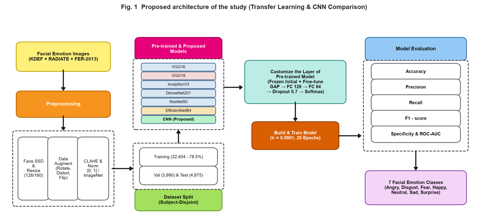
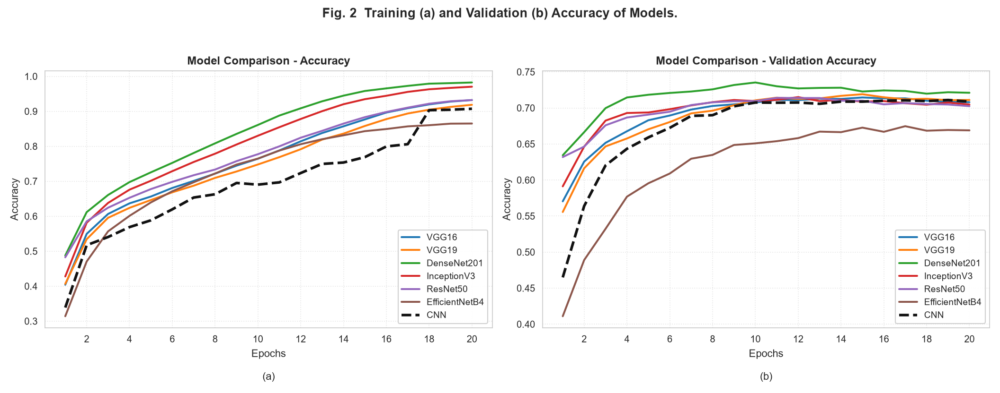
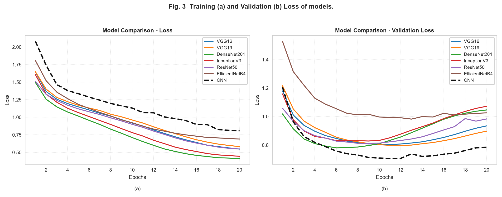
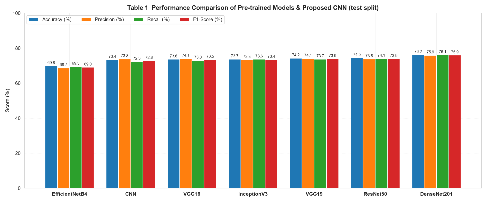
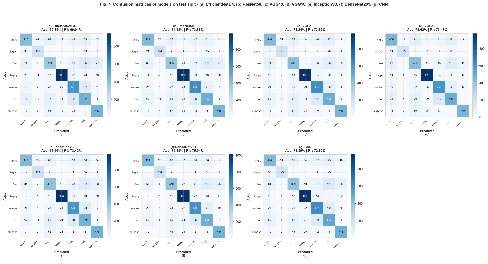

# So sánh Mô hình CNN và 6 Mô hình Học Chuyển Giao (Transfer Learning) trên tập `test` khóa

Sinh tự động bởi `python scripts/so_sanh_mo_hinh.py --split test --unlock-test` — thực hiện theo đúng quy trình và hệ thống biểu đồ của bài báo tham chiếu *"Enhancing Esophageal Cancer Detection Using Transfer Learning Techniques"* (Huynh, Nguyen-Cao et al., TDMU), đánh giá trên cùng **4,875 ảnh** của bộ dữ liệu khuôn mặt đa văn hóa 3 nguồn (`KDEF + RADIATE + FER-2013`), cùng hàm tính độ đo `compute_multicultural_metrics`.

Kiểm tra toàn vẹn: `y_true` của toàn bộ 9 mô hình trùng khớp = **True**, thứ tự ảnh theo manifest = **True**.

## 1. Kiến trúc đề xuất & Quy trình Học chuyển giao (Theo Fig. 1 bài báo tham chiếu)

- **6 Mô hình tiền huấn luyện (Pre-trained Models trên ImageNet-1K):** `VGG16`, `VGG19`, `InceptionV3`, `DenseNet201`, `ResNet50`, `EfficientNetB4`.
- **Cấu trúc tinh chỉnh tầng phân loại (*Customize the Layer of Pre-trained Model*, Mục 3.2 bài báo):**
  - Đóng băng các tầng trích xuất đặc trưng đầu (*frozen initial layers*) để giữ lại đặc trưng cạnh, kết cấu, hình thái cơ bản.
  - Tinh chỉnh các tầng sâu phía sau (*fine-tuned later layers*) kết hợp đầu phân loại tùy chỉnh: `Global Average Pooling` → `FC(128)` → `FC(64)` → `Dropout(0.7)` → `FC(7, Softmax)`.
  - Huấn luyện với tốc độ học `lr = 0.0001` (`1e-4`), tăng cường dữ liệu (*Rotation, Distortion, Flipping*) để xử lý mất cân bằng lớp trong **20 epochs**.
- **Mô hình đề xuất của nhóm (`CNN` — `KDEF_Stem2Ch_MS4_Symmetric`):** Kiến trúc CNN đa tỉ lệ đối xứng chuyên biệt cho nhận dạng cảm xúc khuôn mặt (**1.349.165 tham số**, dung lượng **5,19 MB**).

*Fig. 1: Sơ đồ kiến trúc tổng thể của nghiên cứu (Proposed architecture of the study).* 

## 2. Biểu đồ Hội tụ Accuracy & Loss qua 20 Epochs (Theo Fig. 2 & Fig. 3 bài báo tham chiếu)

*Fig. 2: Training (a) and Validation (b) Accuracy of Models (VGG16, VGG19, DenseNet201, InceptionV3, ResNet50, EfficientNetB4, và CNN).* 

*Fig. 3: Training (a) and Validation (b) Loss of Models qua 20 epochs.* 

## 3. Bảng So Sánh Hiệu Năng (Table 1 — Performance Comparison of Pre-trained Models & CNN)

| Model | Accuracy | Precision (Macro / Weighted) | Recall (Macro / Weighted) | F1-Score (Macro / Weighted) | Specificity | ROC-AUC | Số tham số | Tệp (MB) |
|---|---:|---:|---:|---:|---:|---:|---:|---:|
| EfficientNetB4 | 69.85% | 68.71% / 69.88% | 69.51% / 69.85% | 69.01% / 69.78% | 94.93% | 0.9249 | 17,787,215 | 68.61 MB |
| **CNN** | **73.39%** | 73.81% / 73.66% | 72.30% / 73.39% | **72.82%** / 73.33% | 95.50% | 0.9450 | 1,349,165 | 5.19 MB |
| VGG16 | 73.62% | 74.09% / 73.84% | 72.96% / 73.62% | 73.47% / 73.69% | 95.54% | 0.9376 | 14,789,447 | 56.44 MB |
| InceptionV3 | 73.66% | 73.32% / 73.55% | 73.60% / 73.66% | 73.42% / 73.56% | 95.56% | 0.9422 | 22,056,935 | 84.49 MB |
| VGG19 | 74.24% | 74.11% / 74.27% | 73.70% / 74.24% | 73.85% / 74.20% | 95.65% | 0.9418 | 20,099,143 | 76.70 MB |
| ResNet50 | 74.48% | 73.79% / 74.22% | 74.08% / 74.48% | 73.88% / 74.29% | 95.69% | 0.9442 | 23,779,399 | 91.04 MB |
| DenseNet201 | 76.18% | 75.92% / 75.82% | 76.08% / 76.18% | 75.94% / 75.94% | 95.97% | 0.9499 | 18,347,911 | 71.33 MB |

*Biểu đồ Table 1: Đối sánh trực quan Accuracy, Precision, Recall và F1-Score giữa 6 mô hình Transfer Learning và mô hình CNN.* 

## 4. Ma Trận Nhầm Lẫn Của Các Mô Hình (Fig. 4 — Confusion Matrices)

*Fig. 4: Confusion matrices of pre-trained models and proposed CNN.* 

## 5. Bảng Tổng Hợp Toàn Bộ Mô Hình (Bao gồm cả Baselines bổ sung)

| Mô hình | Accuracy | Macro-F1 | Weighted-F1 | Macro-Precision | Macro-Recall | Specificity | ROC-AUC (OvR) | Ảnh đúng |
|---|---:|---:|---:|---:|---:|---:|---:|---:|
| CNN (KDEF_Stem2Ch_MS4_Symmetric) | 73.39% | 72.82% | 73.33% | 73.81% | 72.30% | 95.50% | 0.9450 | 3,578/4,875 |
| VGG16 (ImageNet Transfer Learning) | 73.62% | 73.47% | 73.69% | 74.09% | 72.96% | 95.54% | 0.9376 | 3,589/4,875 |
| VGG19 (ImageNet Transfer Learning) | 74.24% | 73.85% | 74.20% | 74.11% | 73.70% | 95.65% | 0.9418 | 3,619/4,875 |
| InceptionV3 (ImageNet Transfer Learning) | 73.66% | 73.42% | 73.56% | 73.32% | 73.60% | 95.56% | 0.9422 | 3,591/4,875 |
| DenseNet201 (ImageNet Transfer Learning) | 76.18% | 75.94% | 75.94% | 75.92% | 76.08% | 95.97% | 0.9499 | 3,714/4,875 |
| ResNet50 (ImageNet Transfer Learning) | 74.48% | 73.88% | 74.29% | 73.79% | 74.08% | 95.69% | 0.9442 | 3,631/4,875 |
| EfficientNetB4 (ImageNet Transfer Learning) | 69.85% | 69.01% | 69.78% | 68.71% | 69.51% | 94.93% | 0.9249 | 3,405/4,875 |
| HOG + SVM (LinearSVC) | 44.57% | 41.59% | 42.84% | 41.14% | 43.65% | 90.59% | 0.7942 | 2,173/4,875 |
| ResNet-18 (IMAGENET1K_V1) | 74.28% | 73.81% | 74.08% | 73.77% | 74.08% | 95.66% | 0.9492 | 3,621/4,875 |

## 6. Theo từng nguồn dữ liệu (KDEF, RADIATE, FER-2013)

| Mô hình | KDEF Acc / F1 (980 ảnh) | RADIATE Acc / F1 (306 ảnh) | FER-2013 Acc / F1 (3,589 ảnh) |
|---|---:|---:|---:|
| CNN | 86.53% / 86.56% | 84.97% / 84.37% | 68.82% / 66.30% |
| VGG16 | 88.27% / 88.40% | 87.58% / 86.89% | 68.43% / 66.42% |
| VGG19 | 89.08% / 89.21% | 86.93% / 86.02% | 69.10% / 66.97% |
| InceptionV3 | 86.02% / 85.92% | 84.97% / 83.39% | 69.32% / 67.83% |
| DenseNet201 | 86.63% / 86.50% | 85.95% / 85.38% | 72.50% / 71.53% |
| ResNet50 | 87.65% / 87.57% | 85.62% / 84.56% | 69.94% / 67.72% |
| EfficientNetB4 | 78.27% / 77.70% | 66.99% / 66.02% | 67.79% / 65.79% |
| HOG + SVM | 41.12% / 38.19% | 40.85% / 37.08% | 45.83% / 38.08% |
| ResNet-18 | 87.35% / 87.44% | 84.31% / 83.19% | 69.85% / 67.92% |

## 7. Theo từng lớp cảm xúc (F1-Score 7 cảm xúc)

| Cảm xúc | Số ảnh | EfficientNetB4 | CNN | VGG16 | InceptionV3 | VGG19 | ResNet50 | DenseNet201 |
|---|---:|---:|---:|---:|---:|---:|---:|---:|
| angry | 675 | 0.6205 | 0.6569 | 0.6662 | 0.6785 | 0.6733 | 0.6813 | 0.6976 |
| disgust | 239 | 0.7298 | 0.7775 | 0.8096 | 0.8172 | 0.8059 | 0.8033 | 0.8530 |
| fear | 712 | 0.5398 | 0.5998 | 0.6091 | 0.5899 | 0.6030 | 0.5869 | 0.6115 |
| happy | 1,083 | 0.8880 | 0.9001 | 0.9065 | 0.9060 | 0.9103 | 0.9072 | 0.9138 |
| neutral | 810 | 0.6863 | 0.7260 | 0.7231 | 0.7264 | 0.7357 | 0.7484 | 0.7637 |
| sad | 778 | 0.5843 | 0.6236 | 0.6126 | 0.6089 | 0.6286 | 0.6418 | 0.6517 |
| surprise | 578 | 0.7820 | 0.8136 | 0.8161 | 0.8127 | 0.8130 | 0.8024 | 0.8245 |
| **Macro-F1** | | **0.6901** | **0.7282** | **0.7347** | **0.7342** | **0.7385** | **0.7388** | **0.7594** |

## 8. Quy mô tham số và tốc độ suy luận

| Mô hình | Số tham số | Phép nhân-cộng / ảnh | Tệp mô hình | CPU ms/ảnh (FPS) | GPU ms/ảnh (FPS) | Cấu hình đầu vào & Head |
|---|---:|---:|---:|---:|---:|---|
| CNN | 1,349,165 | 1.351 tỉ | 5.19 MB | 106.03 (9) | 5.91 (169) | xám 160x160, CLAHE=True, mean=0.517243, std=0.264053 |
| VGG16 | 14,789,447 | 7.830 tỉ | 56.44 MB | 169.75 (6) | 4.40 (227) | xám 160x160 lặp 3 kênh RGB, chuẩn hóa ImageNet, GAP->128->64->Drop(0.7)->7 |
| VGG19 | 20,099,143 | 9.953 tỉ | 76.70 MB | 222.58 (4) | 6.43 (156) | xám 160x160 lặp 3 kênh RGB, chuẩn hóa ImageNet, GAP->128->64->Drop(0.7)->7 |
| InceptionV3 | 22,056,935 | 1.979 tỉ | 84.49 MB | 367.92 (3) | 30.10 (33) | xám 192x192 lặp 3 kênh RGB, chuẩn hóa ImageNet, GAP->128->64->Drop(0.7)->7 |
| DenseNet201 | 18,347,911 | 2.189 tỉ | 71.33 MB | 573.83 (2) | 59.31 (17) | xám 160x160 lặp 3 kênh RGB, chuẩn hóa ImageNet, GAP->128->64->Drop(0.7)->7 |
| ResNet50 | 23,779,399 | 2.086 tỉ | 91.04 MB | 160.35 (6) | 15.39 (65) | xám 160x160 lặp 3 kênh RGB, chuẩn hóa ImageNet, GAP->128->64->Drop(0.7)->7 |
| EfficientNetB4 | 17,787,215 | 0.768 tỉ | 68.61 MB | 191.72 (5) | 37.17 (27) | xám 160x160 lặp 3 kênh RGB, chuẩn hóa ImageNet, GAP->128->64->Drop(0.7)->7 |
| HOG + SVM | 20,419 | 0.000 tỉ | 0.10 MB | 1.30 (766) | – (chỉ CPU) | HOG 160x160, ô 16, 9 hướng -> 2916 chiều, C=0.0002 |
| ResNet-18 | 11,180,103 | 0.925 tỉ | 42.73 MB | 77.53 (13) | 6.66 (150) | xám 160x160 lặp 3 kênh, chuẩn hóa ImageNet |
