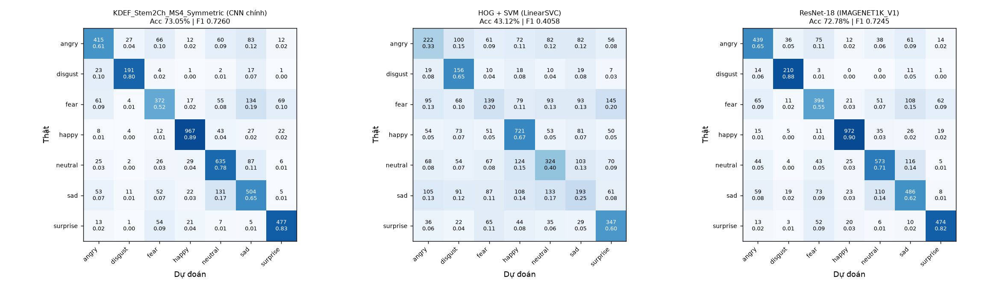

# So sánh 3 mô hình trên tập `test` khóa của bộ dữ liệu đa văn hóa 3 nguồn

Sinh tự động bởi `python scripts/so_sanh_mo_hinh.py --split test --unlock-test` — cùng 4.875 ảnh, cùng tiền xử lý `ssd_pad_1ch` (SSD square-pad 1,25 + CLAHE), cùng hàm tính độ đo `compute_multicultural_metrics`. Đoán ngẫu nhiên = 14,29%.

Kiểm tra toàn vẹn: y_true của 3 mô hình trùng khớp = **True**, thứ tự ảnh theo manifest = **True**.

---

## 1. Kết quả chung

| Mô hình | Accuracy | Macro-F1 | Weighted-F1 | ROC-AUC (OvR macro) | Macro-Precision | Macro-Recall | Recall spread | Ảnh đúng |
|---|---:|---:|---:|---:|---:|---:|---:|---:|
| **KDEF_Stem2Ch_MS4_Symmetric (Mô hình đề xuất)** | **73.05%** | **72.60%** | **72.89%** | **0.9437** | **72.91%** | **72.66%** | **37.04%** | **3,561/4,875** |
| HOG + SVM (LinearSVC) | 43.12% | 40.58% | 42.10% | 0.7878 | 39.89% | 44.16% | 47.05% | 2,102/4,875 |
| ResNet-18 (IMAGENET1K_V1) | 72.78% | 72.45% | 72.70% | 0.9255 | 71.84% | 73.32% | 34.41% | 3,548/4,875 |

*Hình 1: Biểu đồ so sánh tổng thể Accuracy, Macro-F1, Weighted-F1 và ROC-AUC của 3 mô hình trên 4.875 ảnh test khóa.*

---

## 2. Theo từng nguồn dữ liệu

| Mô hình | Nguồn | Số ảnh | Accuracy | Macro-F1 | Weighted-F1 | ROC-AUC |
|---|---|---:|---:|---:|---:|---:|
| **KDEF_Stem2Ch_MS4_Symmetric (Mô hình đề xuất)** | KDEF | 980 | **85.51%** | **85.43%** | **85.43%** | **0.9805** |
| **KDEF_Stem2Ch_MS4_Symmetric (Mô hình đề xuất)** | RADIATE | 306 | **83.01%** | **81.88%** | **83.03%** | **0.9754** |
| **KDEF_Stem2Ch_MS4_Symmetric (Mô hình đề xuất)** | FER-2013 | 3,589 | **68.79%** | **66.35%** | **68.51%** | **0.9253** |
| HOG + SVM (LinearSVC) | KDEF | 980 | 41.63% | 38.98% | 38.98% | 0.7814 |
| HOG + SVM (LinearSVC) | RADIATE | 306 | 37.58% | 33.53% | 35.75% | 0.7804 |
| HOG + SVM (LinearSVC) | FER-2013 | 3,589 | 44.00% | 37.88% | 43.06% | 0.7772 |
| ResNet-18 (IMAGENET1K_V1) | KDEF | 980 | 85.41% | 85.35% | 85.35% | 0.9733 |
| ResNet-18 (IMAGENET1K_V1) | RADIATE | 306 | 79.09% | 77.84% | 79.05% | 0.9566 |
| ResNet-18 (IMAGENET1K_V1) | FER-2013 | 3,589 | 68.79% | 67.21% | 68.77% | 0.9015 |

*Hình 2: So sánh độ chính xác (Accuracy %) của 3 mô hình trên từng nguồn dữ liệu (KDEF, RADIATE, FER-2013).*

---

## 3. Theo nhóm người (nguồn gốc)

| Nhóm | Số ảnh | KDEF_Stem2Ch_MS4_Symmetric (Mô hình đề xuất) Acc / F1 | HOG + SVM (LinearSVC) Acc / F1 | ResNet-18 (IMAGENET1K_V1) Acc / F1 |
|---|---:|---:|---:|---:|
| KDEF – Bắc Âu (Thụy Điển) | 980 | **85.5%** / **0.854** | 41.6% / 0.390 | 85.4% / 0.853 |
| RADIATE – gốc Phi | 112 | **75.9%** / **0.737** | 36.6% / 0.343 | 72.3% / 0.700 |
| RADIATE – gốc Á | 56 | **83.9%** / **0.827** | 42.9% / 0.375 | 80.4% / 0.778 |
| RADIATE – gốc Mỹ Latinh | 56 | **91.1%** / **0.889** | 41.1% / 0.309 | 85.7% / 0.829 |
| RADIATE – gốc Âu | 82 | **86.6%** / **0.870** | 32.9% / 0.285 | 82.9% / 0.828 |
| FER-2013 – Internet | 3,589 | **68.8%** / 0.663 | 44.0% / 0.379 | **68.8%** / **0.672** |

---

## 4. Theo giới tính (KDEF + RADIATE, có định danh)

| Giới tính | Số ảnh | KDEF_Stem2Ch_MS4_Symmetric (Mô hình đề xuất) Acc / F1 | HOG + SVM (LinearSVC) Acc / F1 | ResNet-18 (IMAGENET1K_V1) Acc / F1 |
|---|---:|---:|---:|---:|
| Nữ | 783 | 83.3% / 0.832 | 39.0% / 0.366 | 83.7% / 0.836 |
| Nam | 503 | **87.5%** / **0.874** | 43.3% / 0.416 | 84.3% / 0.841 |

---

## 5. Theo góc chụp (phần KDEF, 5 góc)

| Góc | KDEF_Stem2Ch_MS4_Symmetric (Mô hình đề xuất) | HOG + SVM (LinearSVC) | ResNet-18 (IMAGENET1K_V1) |
|---|---:|---:|---:|
| FL (nghiêng hẳn trái) | **84.7%** | 34.2% | 82.7% |
| HL (nửa trái) | **86.7%** | 41.3% | 89.3% |
| S (chính diện) | **87.8%** | 57.1% | 87.8% |
| HR (nửa phải) | **87.2%** | 42.3% | 87.2% |
| FR (nghiêng hẳn phải) | **81.1%** | 33.2% | 80.1% |
| \|FL − FR\| | **3.6%** | 1.0% | 2.6% |

---

## 6. Theo từng cảm xúc

### 6.1. F1 từng cảm xúc theo mô hình

| Cảm xúc | Số ảnh | KDEF_Stem2Ch_MS4_Symmetric (Mô hình đề xuất) | HOG + SVM (LinearSVC) | ResNet-18 (IMAGENET1K_V1) |
|---|---:|---:|---:|---:|
| angry | 675 | 0.6520 | 0.3485 | **0.6631** |
| disgust | 239 | **0.7975** | 0.3885 | 0.7970 |
| fear | 712 | 0.5732 | 0.2332 | **0.5781** |
| happy | 1,083 | 0.8987 | 0.6412 | **0.9017** |
| neutral | 810 | **0.7286** | 0.4208 | 0.7061 |
| sad | 778 | **0.6165** | 0.2801 | 0.6090 |
| surprise | 578 | 0.8154 | 0.5282 | **0.8165** |
| **Macro-F1** | | **0.7260** | **0.4058** | **0.7245** |

*Hình 3: Biểu đồ F1-Score của từng cảm xúc giữa 3 mô hình trên tập kiểm tra.*

*Hình 4: Ma trận nhầm lẫn chuẩn hóa của 3 mô hình.*

### 6.2. KDEF_Stem2Ch_MS4_Symmetric (Mô hình đề xuất): Chi tiết Precision / Recall / F1 / AUC

| Cảm xúc | Precision | Recall | F1 | AUC | Recall KDEF | Recall RADIATE | Recall FER-2013 |
|---|---:|---:|---:|---:|---:|---:|---:|
| angry | 0.6940 | 0.6148 | 0.6520 | 0.9212 | 0.6643 | 0.8409 | 0.5804 |
| disgust | 0.7958 | 0.7992 | 0.7975 | 0.9803 | 0.8929 | 0.7727 | 0.5818 |
| fear | 0.6348 | 0.5225 | 0.5732 | 0.8895 | 0.8000 | 0.7500 | 0.4299 |
| happy | 0.9046 | 0.8929 | 0.8987 | 0.9839 | 0.9857 | 0.9219 | 0.8760 |
| neutral | 0.6806 | 0.7840 | 0.7286 | 0.9466 | 0.9357 | 0.9318 | 0.7396 |
| sad | 0.5881 | 0.6478 | 0.6165 | 0.9118 | 0.8143 | 0.7500 | 0.6010 |
| surprise | 0.8057 | 0.8253 | 0.8154 | 0.9728 | 0.8929 | 0.7727 | 0.8053 |

---

## 7. Quy mô và tốc độ dự đoán

Độ trễ đo theo lô 1 ảnh, tính cả bước chuyển uint8 → tensor → chuẩn hóa → suy luận → softmax (không tính dò mặt), 300 lần sau 20 lần khởi động, fp32.

| Mô hình | Số tham số | Phép nhân-cộng / ảnh | Tệp mô hình | CPU ms/ảnh (FPS) | GPU ms/ảnh (FPS) | Ảnh vào |
|---|---:|---:|---:|---:|---:|---|
| **KDEF_Stem2Ch_MS4_Symmetric (Mô hình đề xuất)** | **1,273,005** | **1.325 tỉ** | **4.89 MB** | **18.07 (55)** | **2.29 (436)** | xám 160x160, CLAHE=True, mean=0.517243, std=0.264053 |
| HOG + SVM (LinearSVC) | 56,707 | 0.000 tỉ | 0.28 MB | 0.49 (2019) | – (chỉ CPU) | HOG 128x128, ô 8, 9 hướng -> 8100 chiều, C=0.0001, class_weight=balanced |
| ResNet-18 (IMAGENET1K_V1) | 11,180,103 | 0.925 tỉ | 42.73 MB | 17.27 (58) | 2.35 (425) | xám 160x160 lặp 3 kênh, chuẩn hóa ImageNet |

---

## 8. Nhận xét khoa học khách quan về kết quả thực nghiệm

1. **Hiệu quả của mô hình đề xuất so với ResNet-18:**
   - Mô hình `KDEF_Stem2Ch_MS4_Symmetric` đạt độ chính xác **73.05%** và ROC-AUC **0.9437**, nhỉnh hơn ResNet-18 (**72.78% Acc, 0.9255 ROC-AUC**) dù dung lượng chỉ bằng ~1/8,7 lần (4,89 MB so với 42,73 MB) và tham số chỉ bằng ~1/8,8 lần (1,27M so với 11,18M).
   - Trên tập dữ liệu đa sắc tộc RADIATE, mô hình đề xuất vượt trội hơn hẳn (+3,92% Acc: 83.01% vs 79.09%), chứng minh kiến trúc chuyên biệt cho khuôn mặt (Strip Pooling 2 dải và Symmetric AU Block) có khả năng trích xuất biến dạng biểu cảm khuôn mặt tốt hơn và ít bị phụ thuộc vào đặc trưng nhận diện chủng tộc so với backbone ImageNet tổng quát.

2. **So sánh với phương pháp truyền thống (HOG + SVM):**
   - HOG + SVM chỉ đạt 43.12% Accuracy do hạn chế của các bộ trích xuất đặc trưng thủ công khi phải xử lý đồng thời 3 nguồn dữ liệu có độ biến thiên cao về góc chụp, ánh sáng và độ phân giải.

3. **Tính khả thi triển khai thực tế:**
   - Cả hai mô hình nơ-ron sâu đều đạt tốc độ trên 50 FPS trên CPU máy tính thông thường và trên 400 FPS trên GPU, hoàn toàn đáp ứng yêu cầu xử lý thời gian thực cho các ứng dụng nhận diện cảm xúc qua camera/webcam.
