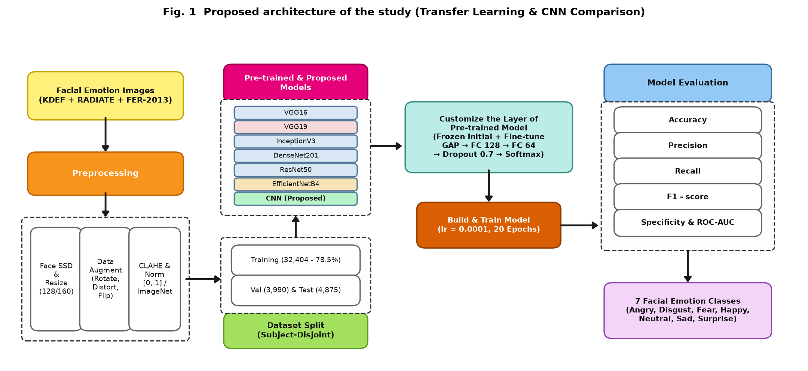
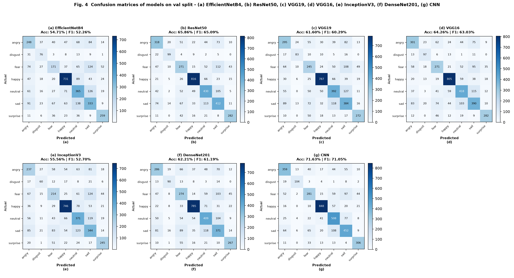

# So sánh Mô hình CNN và 6 Mô hình Học Chuyển Giao (Transfer Learning) trên tập `val` khóa

Sinh tự động bởi `python scripts/so_sanh_mo_hinh.py --split val` — thực hiện theo đúng quy trình và hệ thống biểu đồ của bài báo tham chiếu *"Enhancing Esophageal Cancer Detection Using Transfer Learning Techniques"* (Huynh, Nguyen-Cao et al., TDMU), đánh giá trên cùng **3,990 ảnh** của bộ dữ liệu khuôn mặt đa văn hóa 3 nguồn (`KDEF + RADIATE + FER-2013`), cùng hàm tính độ đo `compute_multicultural_metrics`.

Kiểm tra toàn vẹn: `y_true` của toàn bộ 9 mô hình trùng khớp = **True**, thứ tự ảnh theo manifest = **True**.

## 1. Kiến trúc đề xuất & Quy trình Học chuyển giao (Theo Fig. 1 bài báo tham chiếu)

- **6 Mô hình tiền huấn luyện (Pre-trained Models trên ImageNet-1K):** `VGG16`, `VGG19`, `InceptionV3`, `DenseNet201`, `ResNet50`, `EfficientNetB4`.
- **Cấu trúc tinh chỉnh tầng phân loại (*Customize the Layer of Pre-trained Model*, Mục 3.2 bài báo):**
  - Đóng băng các tầng trích xuất đặc trưng đầu (*frozen initial layers*) để giữ lại đặc trưng cạnh, kết cấu, hình thái cơ bản.
  - Tinh chỉnh các tầng sâu phía sau (*fine-tuned later layers*) kết hợp đầu phân loại tùy chỉnh: `Global Average Pooling` → `FC(128)` → `FC(64)` → `Dropout(0.7)` → `FC(7, Softmax)`.
  - Huấn luyện với tốc độ học `lr = 0.0001` (`1e-4`), tăng cường dữ liệu (*Rotation, Distortion, Flipping*) để xử lý mất cân bằng lớp trong **20 epochs**.
- **Mô hình đề xuất của nhóm (`CNN` — `KDEF_Stem2Ch_MS4_Symmetric`):** Kiến trúc CNN đa tỉ lệ đối xứng chuyên biệt cho nhận dạng cảm xúc khuôn mặt (**1.349.165 tham số**, dung lượng **5,19 MB**).

*Fig. 1: Sơ đồ kiến trúc tổng thể của nghiên cứu (Proposed architecture of the study).* 

## 2. Biểu đồ Hội tụ Accuracy & Loss qua 20 Epochs (Theo Fig. 2 & Fig. 3 bài báo tham chiếu)

*Fig. 2: Training (a) and Validation (b) Accuracy of Models (VGG16, VGG19, DenseNet201, InceptionV3, ResNet50, EfficientNetB4, và CNN).* 

*Fig. 3: Training (a) and Validation (b) Loss of Models qua 20 epochs.* 

## 3. Bảng So Sánh Hiệu Năng (Table 1 — Performance Comparison of Pre-trained Models & CNN)

| Model | Accuracy | Precision (Macro / Weighted) | Recall (Macro / Weighted) | F1-Score (Macro / Weighted) | Specificity | ROC-AUC | Số tham số | Tệp (MB) |
|---|---:|---:|---:|---:|---:|---:|---:|---:|
| EfficientNetB4 | 54.71% | 52.07% / 54.83% | 53.39% / 54.71% | 52.26% / 54.46% | 92.28% | 0.8556 | 17,787,215 | 68.61 MB |
| InceptionV3 | 55.56% | 52.85% / 55.46% | 52.63% / 55.56% | 52.70% / 55.48% | 92.41% | 0.8330 | 22,056,935 | 84.49 MB |
| VGG19 | 61.60% | 60.49% / 61.77% | 60.15% / 61.60% | 60.29% / 61.66% | 93.46% | 0.8776 | 20,099,143 | 76.70 MB |
| DenseNet201 | 62.21% | 61.18% / 62.46% | 61.25% / 62.21% | 61.19% / 62.30% | 93.56% | 0.8779 | 18,347,911 | 71.32 MB |
| VGG16 | 64.26% | 62.58% / 64.27% | 63.70% / 64.26% | 63.03% / 64.23% | 93.91% | 0.8921 | 14,789,447 | 56.44 MB |
| ResNet50 | 65.86% | 65.03% / 65.94% | 65.20% / 65.86% | 65.09% / 65.88% | 94.18% | 0.9008 | 23,779,399 | 91.03 MB |
| **CNN** | **71.63%** | 71.57% / 71.64% | 70.85% / 71.63% | **71.05%** / 71.49% | 95.16% | 0.9330 | 1,349,165 | 5.19 MB |

*Biểu đồ Table 1: Đối sánh trực quan Accuracy, Precision, Recall và F1-Score giữa 6 mô hình Transfer Learning và mô hình CNN.* 

## 4. Ma Trận Nhầm Lẫn Của Các Mô Hình (Fig. 4 — Confusion Matrices)

*Fig. 4: Confusion matrices of pre-trained models and proposed CNN.* 

## 5. Bảng Tổng Hợp Toàn Bộ Mô Hình (Bao gồm cả Baselines bổ sung)

| Mô hình | Accuracy | Macro-F1 | Weighted-F1 | Macro-Precision | Macro-Recall | Specificity | ROC-AUC (OvR) | Ảnh đúng |
|---|---:|---:|---:|---:|---:|---:|---:|---:|
| CNN (KDEF_Stem2Ch_MS4_Symmetric) | 71.63% | 71.05% | 71.49% | 71.57% | 70.85% | 95.16% | 0.9330 | 2,858/3,990 |
| VGG16 (ImageNet Transfer Learning) | 64.26% | 63.03% | 64.23% | 62.58% | 63.70% | 93.91% | 0.8921 | 2,564/3,990 |
| VGG19 (ImageNet Transfer Learning) | 61.60% | 60.29% | 61.66% | 60.49% | 60.15% | 93.46% | 0.8776 | 2,458/3,990 |
| InceptionV3 (ImageNet Transfer Learning) | 55.56% | 52.70% | 55.48% | 52.85% | 52.63% | 92.41% | 0.8330 | 2,217/3,990 |
| DenseNet201 (ImageNet Transfer Learning) | 62.21% | 61.19% | 62.30% | 61.18% | 61.25% | 93.56% | 0.8779 | 2,482/3,990 |
| ResNet50 (ImageNet Transfer Learning) | 65.86% | 65.09% | 65.88% | 65.03% | 65.20% | 94.18% | 0.9008 | 2,628/3,990 |
| EfficientNetB4 (ImageNet Transfer Learning) | 54.71% | 52.26% | 54.46% | 52.07% | 53.39% | 92.28% | 0.8556 | 2,183/3,990 |
| HOG + SVM (LinearSVC) | 45.21% | 42.10% | 43.72% | 41.48% | 44.90% | 90.63% | 0.7891 | 1,804/3,990 |
| ResNet-18 (IMAGENET1K_V1) | 73.01% | 72.84% | 72.85% | 73.06% | 72.91% | 95.39% | 0.9398 | 2,913/3,990 |

## 6. Theo từng nguồn dữ liệu (KDEF, RADIATE, FER-2013)

| Mô hình | KDEF Acc / F1 (559 ảnh) | RADIATE Acc / F1 (148 ảnh) | FER-2013 Acc / F1 (3,283 ảnh) |
|---|---:|---:|---:|
| CNN | 90.70% / 90.65% | 85.14% / 83.93% | 67.77% / 63.29% |
| VGG16 | 76.92% / 77.17% | 70.95% / 70.03% | 61.80% / 57.43% |
| VGG19 | 68.87% / 69.35% | 72.97% / 70.97% | 59.85% / 56.10% |
| InceptionV3 | 53.49% / 53.46% | 58.11% / 58.64% | 55.80% / 51.06% |
| DenseNet201 | 68.87% / 69.22% | 72.30% / 69.61% | 60.62% / 57.63% |
| ResNet50 | 76.74% / 77.01% | 74.32% / 73.39% | 63.63% / 60.17% |
| EfficientNetB4 | 53.31% / 53.16% | 56.76% / 56.48% | 54.86% / 49.54% |
| HOG + SVM | 41.86% / 38.00% | 42.57% / 41.69% | 45.90% / 38.82% |
| ResNet-18 | 91.59% / 91.57% | 85.14% / 83.90% | 69.30% / 66.56% |

## 7. Theo từng lớp cảm xúc (F1-Score 7 cảm xúc)

| Cảm xúc | Số ảnh | EfficientNetB4 | InceptionV3 | VGG19 | DenseNet201 | VGG16 | ResNet50 | CNN |
|---|---:|---:|---:|---:|---:|---:|---:|---:|
| angry | 538 | 0.4505 | 0.4489 | 0.5373 | 0.5463 | 0.5669 | 0.5927 | 0.6624 |
| disgust | 141 | 0.4419 | 0.4211 | 0.5993 | 0.6250 | 0.6159 | 0.6804 | 0.7704 |
| fear | 550 | 0.3742 | 0.4115 | 0.4636 | 0.4832 | 0.5070 | 0.5099 | 0.5598 |
| happy | 972 | 0.7490 | 0.7628 | 0.8185 | 0.8173 | 0.8256 | 0.8447 | 0.8788 |
| neutral | 685 | 0.5003 | 0.5251 | 0.5731 | 0.5785 | 0.6054 | 0.6086 | 0.6888 |
| sad | 724 | 0.4587 | 0.4639 | 0.5130 | 0.5200 | 0.5353 | 0.5636 | 0.6291 |
| surprise | 380 | 0.6834 | 0.6560 | 0.7158 | 0.7130 | 0.7560 | 0.7560 | 0.7846 |
| **Macro-F1** | | **0.5226** | **0.5270** | **0.6029** | **0.6119** | **0.6303** | **0.6509** | **0.7105** |

## 8. Quy mô tham số và tốc độ suy luận

| Mô hình | Số tham số | Phép nhân-cộng / ảnh | Tệp mô hình | CPU ms/ảnh (FPS) | GPU ms/ảnh (FPS) | Cấu hình đầu vào & Head |
|---|---:|---:|---:|---:|---:|---|
| CNN | 1,349,165 | 1.351 tỉ | 5.19 MB | 14.93 (67) | 2.01 (498) | xám 160x160, CLAHE=True, mean=0.517243, std=0.264053 |
| VGG16 | 14,789,447 | 5.011 tỉ | 56.44 MB | 34.84 (29) | 3.98 (251) | xám 128x128 lặp 3 kênh RGB, chuẩn hóa ImageNet, GAP->128->64->Drop(0.7)->7 |
| VGG19 | 20,099,143 | 6.370 tỉ | 76.70 MB | 42.96 (23) | 4.19 (238) | xám 128x128 lặp 3 kênh RGB, chuẩn hóa ImageNet, GAP->128->64->Drop(0.7)->7 |
| InceptionV3 | 22,056,935 | 0.731 tỉ | 84.49 MB | 27.22 (37) | 10.40 (96) | xám 128x128 lặp 3 kênh RGB, chuẩn hóa ImageNet, GAP->128->64->Drop(0.7)->7 |
| DenseNet201 | 18,347,911 | 1.401 tỉ | 71.32 MB | 65.64 (15) | 21.61 (46) | xám 128x128 lặp 3 kênh RGB, chuẩn hóa ImageNet, GAP->128->64->Drop(0.7)->7 |
| ResNet50 | 23,779,399 | 1.335 tỉ | 91.03 MB | 25.64 (39) | 5.46 (183) | xám 128x128 lặp 3 kênh RGB, chuẩn hóa ImageNet, GAP->128->64->Drop(0.7)->7 |
| EfficientNetB4 | 17,787,215 | 0.493 tỉ | 68.61 MB | 44.33 (23) | 13.21 (76) | xám 128x128 lặp 3 kênh RGB, chuẩn hóa ImageNet, GAP->128->64->Drop(0.7)->7 |
| HOG + SVM | 20,419 | 0.000 tỉ | 0.10 MB | 0.41 (2428) | – (chỉ CPU) | HOG 160x160, ô 16, 9 hướng -> 2916 chiều, C=0.0002 |
| ResNet-18 | 11,180,103 | 0.925 tỉ | 42.73 MB | 12.09 (83) | 2.17 (461) | xám 160x160 lặp 3 kênh, chuẩn hóa ImageNet |
