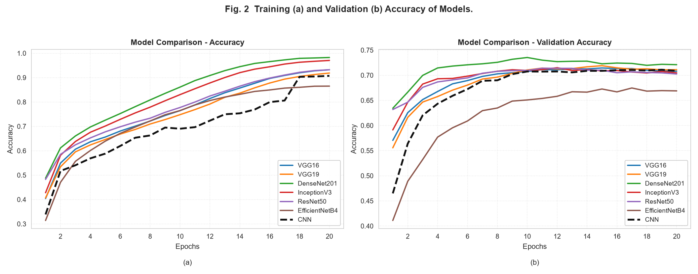
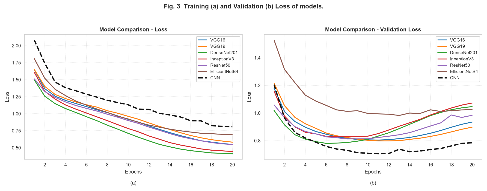
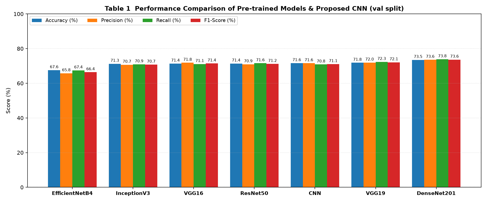

# So sánh Mô hình CNN và 6 Mô hình Học Chuyển Giao (Transfer Learning) trên tập `val` khóa

Sinh tự động bởi `python scripts/so_sanh_mo_hinh.py --split val` — thực hiện theo đúng quy trình và hệ thống biểu đồ của bài báo tham chiếu *"Enhancing Esophageal Cancer Detection Using Transfer Learning Techniques"* (Huynh, Nguyen-Cao et al., TDMU), đánh giá trên cùng **3,990 ảnh** của bộ dữ liệu khuôn mặt đa văn hóa 3 nguồn (`KDEF + RADIATE + FER-2013`), cùng hàm tính độ đo `compute_multicultural_metrics`.

Kiểm tra toàn vẹn: `y_true` của toàn bộ 9 mô hình trùng khớp = **True**, thứ tự ảnh theo manifest = **True**.

## 1. Kiến trúc đề xuất & Quy trình Học chuyển giao (Theo Fig. 1 bài báo tham chiếu)

- **6 Mô hình tiền huấn luyện (Pre-trained Models trên ImageNet-1K):** `VGG16`, `VGG19`, `InceptionV3`, `DenseNet201`, `ResNet50`, `EfficientNetB4`.
- **Cấu trúc tinh chỉnh tầng phân loại (*Customize the Layer of Pre-trained Model*, Mục 3.2 bài báo):**
  - Đóng băng các tầng trích xuất đặc trưng đầu (*frozen initial layers*) để giữ lại đặc trưng cạnh, kết cấu, hình thái cơ bản.
  - Tinh chỉnh các tầng sâu phía sau (*fine-tuned later layers*) kết hợp đầu phân loại tùy chỉnh: `Global Average Pooling` → `FC(128)` → `FC(64)` → `Dropout(0.7)` → `FC(7, Softmax)`.
  - Huấn luyện với tốc độ học `lr = 0.0001` (`1e-4`), tăng cường dữ liệu (*Rotation, Distortion, Flipping*) để xử lý mất cân bằng lớp trong **20 epochs**.
- **Mô hình đề xuất của nhóm (`CNN` — `KDEF_Stem2Ch_MS4_Symmetric`):** Kiến trúc CNN đa tỉ lệ đối xứng chuyên biệt cho nhận dạng cảm xúc khuôn mặt (**1.349.165 tham số**, dung lượng **5,19 MB**).

*Fig. 1: Sơ đồ kiến trúc tổng thể của nghiên cứu (Proposed architecture of the study).* 

## 2. Biểu đồ Hội tụ Accuracy & Loss qua 20 Epochs (Theo Fig. 2 & Fig. 3 bài báo tham chiếu)

*Fig. 2: Training (a) and Validation (b) Accuracy of Models (VGG16, VGG19, DenseNet201, InceptionV3, ResNet50, EfficientNetB4, và CNN).* 

*Fig. 3: Training (a) and Validation (b) Loss of Models qua 20 epochs.* 

## 3. Bảng So Sánh Hiệu Năng (Table 1 — Performance Comparison of Pre-trained Models & CNN)

| Model | Accuracy | Precision (Macro / Weighted) | Recall (Macro / Weighted) | F1-Score (Macro / Weighted) | Specificity | ROC-AUC | Số tham số | Tệp (MB) |
|---|---:|---:|---:|---:|---:|---:|---:|---:|
| EfficientNetB4 | 67.57% | 65.77% / 67.81% | 67.44% / 67.57% | 66.36% / 67.50% | 94.51% | 0.9106 | 17,787,215 | 68.61 MB |
| InceptionV3 | 71.25% | 70.69% / 71.20% | 70.91% / 71.25% | 70.75% / 71.18% | 95.10% | 0.9315 | 22,056,935 | 84.49 MB |
| VGG16 | 71.35% | 71.83% / 71.41% | 71.11% / 71.35% | 71.42% / 71.33% | 95.11% | 0.9309 | 14,789,447 | 56.44 MB |
| ResNet50 | 71.40% | 70.94% / 71.15% | 71.56% / 71.40% | 71.16% / 71.19% | 95.12% | 0.9338 | 23,779,399 | 91.04 MB |
| **CNN** | **71.63%** | 71.57% / 71.64% | 70.85% / 71.63% | **71.05%** / 71.49% | 95.16% | 0.9330 | 1,349,165 | 5.19 MB |
| VGG19 | 71.83% | 71.96% / 71.78% | 72.31% / 71.83% | 72.10% / 71.77% | 95.19% | 0.9369 | 20,099,143 | 76.70 MB |
| DenseNet201 | 73.48% | 73.57% / 73.32% | 73.83% / 73.48% | 73.64% / 73.35% | 95.48% | 0.9394 | 18,347,911 | 71.33 MB |

*Biểu đồ Table 1: Đối sánh trực quan Accuracy, Precision, Recall và F1-Score giữa 6 mô hình Transfer Learning và mô hình CNN.* 

## 4. Ma Trận Nhầm Lẫn Của Các Mô Hình (Fig. 4 — Confusion Matrices)

*Fig. 4: Confusion matrices of pre-trained models and proposed CNN.* 

## 5. Bảng Tổng Hợp Toàn Bộ Mô Hình (Bao gồm cả Baselines bổ sung)

| Mô hình | Accuracy | Macro-F1 | Weighted-F1 | Macro-Precision | Macro-Recall | Specificity | ROC-AUC (OvR) | Ảnh đúng |
|---|---:|---:|---:|---:|---:|---:|---:|---:|
| CNN (KDEF_Stem2Ch_MS4_Symmetric) | 71.63% | 71.05% | 71.49% | 71.57% | 70.85% | 95.16% | 0.9330 | 2,858/3,990 |
| VGG16 (ImageNet Transfer Learning) | 71.35% | 71.42% | 71.33% | 71.83% | 71.11% | 95.11% | 0.9309 | 2,847/3,990 |
| VGG19 (ImageNet Transfer Learning) | 71.83% | 72.10% | 71.77% | 71.96% | 72.31% | 95.19% | 0.9369 | 2,866/3,990 |
| InceptionV3 (ImageNet Transfer Learning) | 71.25% | 70.75% | 71.18% | 70.69% | 70.91% | 95.10% | 0.9315 | 2,843/3,990 |
| DenseNet201 (ImageNet Transfer Learning) | 73.48% | 73.64% | 73.35% | 73.57% | 73.83% | 95.48% | 0.9394 | 2,932/3,990 |
| ResNet50 (ImageNet Transfer Learning) | 71.40% | 71.16% | 71.19% | 70.94% | 71.56% | 95.12% | 0.9338 | 2,849/3,990 |
| EfficientNetB4 (ImageNet Transfer Learning) | 67.57% | 66.36% | 67.50% | 65.77% | 67.44% | 94.51% | 0.9106 | 2,696/3,990 |
| HOG + SVM (LinearSVC) | 45.21% | 42.10% | 43.72% | 41.48% | 44.90% | 90.63% | 0.7891 | 1,804/3,990 |
| ResNet-18 (IMAGENET1K_V1) | 73.01% | 72.84% | 72.85% | 73.06% | 72.91% | 95.39% | 0.9398 | 2,913/3,990 |

## 6. Theo từng nguồn dữ liệu (KDEF, RADIATE, FER-2013)

| Mô hình | KDEF Acc / F1 (559 ảnh) | RADIATE Acc / F1 (148 ảnh) | FER-2013 Acc / F1 (3,283 ảnh) |
|---|---:|---:|---:|
| CNN | 90.70% / 90.65% | 85.14% / 83.93% | 67.77% / 63.29% |
| VGG16 | 91.23% / 91.21% | 85.14% / 83.53% | 67.35% / 64.72% |
| VGG19 | 93.20% / 93.24% | 85.81% / 84.61% | 67.56% / 65.67% |
| InceptionV3 | 90.88% / 90.82% | 86.49% / 84.38% | 67.23% / 63.21% |
| DenseNet201 | 91.95% / 91.88% | 88.51% / 86.92% | 69.66% / 67.12% |
| ResNet50 | 89.45% / 89.42% | 85.14% / 82.84% | 67.71% / 64.65% |
| EfficientNetB4 | 75.13% / 74.97% | 72.30% / 69.36% | 66.07% / 63.34% |
| HOG + SVM | 41.86% / 38.00% | 42.57% / 41.69% | 45.90% / 38.82% |
| ResNet-18 | 91.59% / 91.57% | 85.14% / 83.90% | 69.30% / 66.56% |

## 7. Theo từng lớp cảm xúc (F1-Score 7 cảm xúc)

| Cảm xúc | Số ảnh | EfficientNetB4 | InceptionV3 | VGG16 | ResNet50 | CNN | VGG19 | DenseNet201 |
|---|---:|---:|---:|---:|---:|---:|---:|---:|
| angry | 538 | 0.5921 | 0.6487 | 0.6564 | 0.6624 | 0.6624 | 0.6679 | 0.6704 |
| disgust | 141 | 0.6774 | 0.7518 | 0.7941 | 0.7944 | 0.7704 | 0.8194 | 0.8440 |
| fear | 550 | 0.5091 | 0.5744 | 0.5823 | 0.5503 | 0.5598 | 0.5790 | 0.5971 |
| happy | 972 | 0.8699 | 0.8826 | 0.8802 | 0.8821 | 0.8788 | 0.8809 | 0.8932 |
| neutral | 685 | 0.6436 | 0.6573 | 0.6643 | 0.6793 | 0.6888 | 0.6695 | 0.6927 |
| sad | 724 | 0.5772 | 0.6240 | 0.6102 | 0.6103 | 0.6291 | 0.6165 | 0.6454 |
| surprise | 380 | 0.7762 | 0.8133 | 0.8116 | 0.8025 | 0.7846 | 0.8136 | 0.8122 |
| **Macro-F1** | | **0.6636** | **0.7075** | **0.7142** | **0.7116** | **0.7105** | **0.7210** | **0.7364** |

## 8. Quy mô tham số và tốc độ suy luận

| Mô hình | Số tham số | Phép nhân-cộng / ảnh | Tệp mô hình | CPU ms/ảnh (FPS) | GPU ms/ảnh (FPS) | Cấu hình đầu vào & Head |
|---|---:|---:|---:|---:|---:|---|
| CNN | 1,349,165 | 1.351 tỉ | 5.19 MB | 72.15 (14) | 6.42 (156) | xám 160x160, CLAHE=True, mean=0.517243, std=0.264053 |
| VGG16 | 14,789,447 | 7.830 tỉ | 56.44 MB | 161.20 (6) | 4.42 (226) | xám 160x160 lặp 3 kênh RGB, chuẩn hóa ImageNet, GAP->128->64->Drop(0.7)->7 |
| VGG19 | 20,099,143 | 9.953 tỉ | 76.70 MB | 228.50 (4) | 5.25 (190) | xám 160x160 lặp 3 kênh RGB, chuẩn hóa ImageNet, GAP->128->64->Drop(0.7)->7 |
| InceptionV3 | 22,056,935 | 1.979 tỉ | 84.49 MB | 323.13 (3) | 29.40 (34) | xám 192x192 lặp 3 kênh RGB, chuẩn hóa ImageNet, GAP->128->64->Drop(0.7)->7 |
| DenseNet201 | 18,347,911 | 2.189 tỉ | 71.33 MB | 472.40 (2) | 236.79 (4) | xám 160x160 lặp 3 kênh RGB, chuẩn hóa ImageNet, GAP->128->64->Drop(0.7)->7 |
| ResNet50 | 23,779,399 | 2.086 tỉ | 91.04 MB | 122.26 (8) | 64.70 (16) | xám 160x160 lặp 3 kênh RGB, chuẩn hóa ImageNet, GAP->128->64->Drop(0.7)->7 |
| EfficientNetB4 | 17,787,215 | 0.768 tỉ | 68.61 MB | 171.80 (6) | 176.79 (6) | xám 160x160 lặp 3 kênh RGB, chuẩn hóa ImageNet, GAP->128->64->Drop(0.7)->7 |
| HOG + SVM | 20,419 | 0.000 tỉ | 0.10 MB | 1.26 (793) | – (chỉ CPU) | HOG 160x160, ô 16, 9 hướng -> 2916 chiều, C=0.0002 |
| ResNet-18 | 11,180,103 | 0.925 tỉ | 42.73 MB | 49.17 (20) | 6.29 (159) | xám 160x160 lặp 3 kênh, chuẩn hóa ImageNet |
